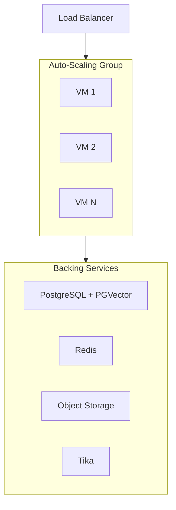

# 自动扩缩容虚拟机上的 Python / Pip {#python--pip-on-auto-scaling-vms}

将 `open-webui serve` 以 systemd 管理的进程形式，部署在云自动扩缩容虚拟机组（AWS ASG、Azure VMSS、GCP MIG）中。

:::info 前置条件
继续之前，请先确认你已经配置好了[共享基础设施要求](/enterprise/deployment#shared-infrastructure-requirements)——包括 PostgreSQL、Redis、向量数据库、共享存储和内容提取服务。
:::

## 何时选择这种模式 {#when-to-choose-this-pattern}

- 你的组织已经具备成熟的 VM 基础设施和运维实践
- 监管或合规要求你必须进行操作系统层直接控制
- 团队容器经验有限，但 Linux 运维能力较强
- 你希望采用更直接的部署方式，而不引入容器编排开销

## 架构 {#architecture}



## 安装 {#installation}

在每台 VM 上通过带 `postgres` 扩展的 pip 安装（它会添加 PostgreSQL 和 PGVector 驱动）：

```bash
python3.12 -m venv /opt/open-webui/venv
/opt/open-webui/venv/bin/pip install "open-webui[postgres]"
```
`all` 扩展还会添加可选的向量存储客户端、Playwright 和 Unstructured；只有在用到其中之一时才安装它。

创建一个 systemd unit 来管理该进程：

```ini
[Unit]
Description=Open WebUI
After=network.target

[Service]
Type=simple
User=openwebui
EnvironmentFile=/etc/open-webui/env
ExecStart=/opt/open-webui/venv/bin/open-webui serve
Restart=always
RestartSec=5

[Install]
WantedBy=multi-user.target
```

将环境变量放在 `/etc/open-webui/env` 中（参见 [关键配置](/enterprise/deployment#critical-configuration)）。同时请设置 `DATA_DIR`，例如设为 `/var/lib/open-webui`，这样本地缓存就不会落在 Python 包目录（默认值）里。

## 扩展策略 {#scaling-strategy}

- **横向扩展**：让自动扩缩容组根据 CPU 利用率或请求数增减 VM。
- **健康检查**：将负载均衡器健康检查指向 `/ready`，它在启动完成且数据库与 Redis 响应后才会应答。`/health` 只表示进程正在运行。
- **每台 VM 一个进程**：保持 `UVICORN_WORKERS=1`，把容量管理交给自动扩缩容系统。
- **粘性会话**：可选，仅在 `ENABLE_WEBSOCKET_SUPPORT=false` 时才需要。参见[会话亲和性](/troubleshooting/multi-replica#session-affinity-sticky-sessions)。

## 关键注意事项 {#key-considerations}

| 注意事项 | 说明 |
| :--- | :--- |
| **OS 补丁** | 你需要自行负责操作系统更新、安全补丁和 Python 运行环境管理。 |
| **Python 环境** | 在虚拟环境中使用 Python 3.11 或 3.12（推荐 3.12）。 |
| **存储** | 由于自动扩缩容组中的 VM 不共享本地文件系统，因此应使用对象存储（如 S3）或共享文件系统（如 NFS）。 |
| **Tika Sidecar** | 可以在每台 VM 上运行 Tika 服务，也可以作为共享服务单独运行。共享实例更便于管理。 |
| **更新** | 先把实例组缩容到单个实例，在其上设置 `ENABLE_DB_MIGRATIONS=true`，更新软件包（`pip install --upgrade "open-webui[postgres]"`）并重启，等待迁移完成，然后在关闭迁移、每台 VM 都运行新版本的情况下重新扩容。参见[更新与迁移](/troubleshooting/multi-replica#updates-and-migrations)。 |

pip 基础安装方式可参考 [快速入门指南](/getting-started/quick-start)。

---

**需要帮助规划企业部署？** 我们的团队正与全球组织合作，共同设计和落地生产级 Open WebUI 环境。

[**联系企业销售 →**](https://openwebui.com/contact/sales)
