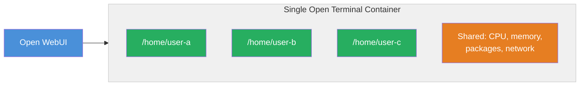
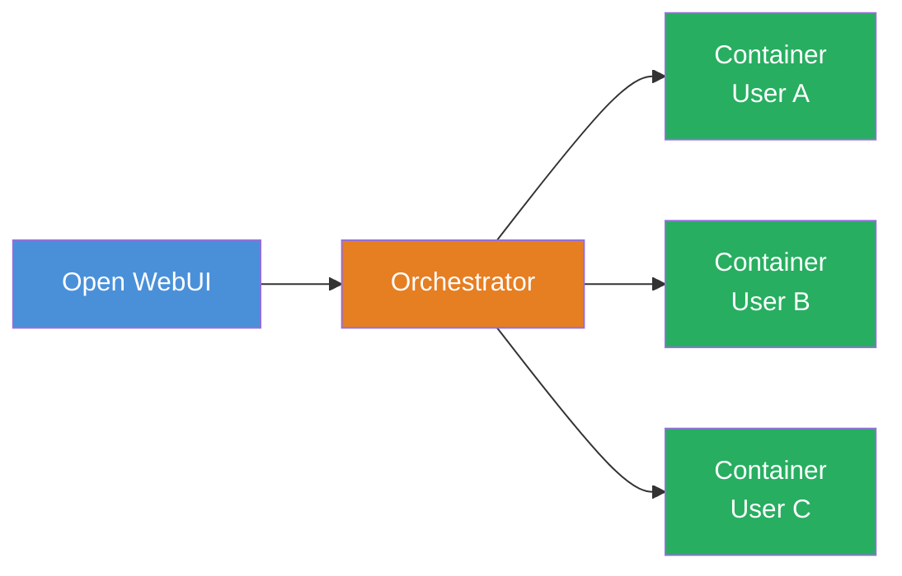

# 为团队配置 Open Terminal {#setting-up-open-terminal-for-a-team}

当团队中有多人需要通过 Open WebUI 访问一台机器时，有两种方案。

| | 单容器 | Terminals |
| :--- | :--- | :--- |
| **工作方式** | 单个容器中使用独立账户 | 每个用户、聊天或模型可以获得独立实例 |
| **隔离** | 在共享容器中使用独立工作区 | 每个用户、聊天或模型拥有独立实例及自己的文件、进程和资源。Docker 后端的容器共享一个网络 |
| **配置** | 一个额外设置 | 额外的编排服务 |
| **适用场景** | 成员之间彼此完全信任的小型团队 | 生产环境、较大团队、不受信任的用户 |
| **包含于** | Open Terminal（免费） | [Terminals](https://github.com/open-webui/terminals)（企业版） |

:::danger 多用户 Open WebUI 部署必读
如果 Open WebUI 实例有**多个用户账户**，并且他们共享同一台机器，就**必须**采用以下两种方案之一。单个 Open Terminal 容器如果没有 `OPEN_TERMINAL_MULTI_USER=true`（或未通过 Terminals 为每个用户分配容器），则所有用户都在同一个 Shell、文件系统和网络命名空间内。因此，任一用户都能读取、修改或替换其他用户的文件，以共享用户身份运行命令，并绑定共享端口。多用户 Open WebUI 不支持这种配置。

**方式 1 隔离工作区。它不是用户之间的安全边界。** 所有人依然共享同一个内核、同一份进程列表、同一个网络命名空间和一套系统资源，而且在容器内配置每用户账户需要提升的权限，所以试图在容器内获得 root 的用户会成功。只在实例上的所有用户享有相同信任级别的场景中使用此模式。

对于存在**不受信任用户**的部署（允许公开注册、面向公众的门户，或用户之间不应访问彼此数据的部署），请采用 **方案 2（通过 Terminals 为每个用户分配容器）**，使用其 Kubernetes 后端及 NetworkPolicy，从而在用户之间建立隔离边界。在方案 1 上叠加 `MACHINE_PROXY_HEADERS` 会限制代理响应在用户浏览器中的行为，但共享容器本身不变。
:::

---

## 方式 1：内置多用户模式 {#option-1-built-in-multi-user-mode}

最简单的方式。添加一个设置，每个人会自动获得独立的工作区。

```bash
docker run -d --name open-terminal -p 8000:8000 \
  -v open-terminal:/home \
  -e OPEN_TERMINAL_MULTI_USER=true \
  -e OPEN_TERMINAL_API_KEY=your-secret-key \
  ghcr.io/open-webui/open-terminal
```

{/* TODO: Screenshot: Docker run command in terminal with the MULTI_USER=true flag highlighted. */}

### 工作原理 {#what-happens}

当用户通过 Open WebUI 使用机器时，Open Terminal 会自动执行以下操作：

1. 根据该用户的 Open WebUI 用户 ID 为其创建个人账户
2. 在 `/home/{user-id}` 设置私有主目录
3. 在其自己的账户下运行所有命令
4. 将每个用户的文件保留在自己的文件夹中

每个用户在文件浏览器中只能看到自己的文件。

{/* TODO: Screenshot: Two views side by side: User A's file browser showing /home/user-a/ with their files, and User B's file browser showing /home/user-b/ with completely different files. */}

### 网络存储上的主目录 {#home-folders-on-network-storage}

每个用户的主目录只向该用户所属的组开放。Open Terminal 本身会加入每个用户的组来访问这些目录，例如在文件浏览器中列出它们。有些 NFS 配置会丢弃这些附加组。此时文件浏览器会报 `403` 和 `Permission denied`，而模型的文件工具仍然可用。如果 NFS 服务器运行 `rpc.mountd --manage-gids`，就会出现这种情况，因为它忽略客户端发送的组，改为在服务器自己的用户列表中查找组。普通 `AUTH_SYS` 最多携带 16 个组，因此拥有主目录的用户超过该数量，也会出现此问题。

请将 `/home` 放在本地存储上，例如上例中的 Docker 卷。如果必须放在 NFS 上，请采用保留客户端组的配置（例如 Kerberos），也可以在 NFS 服务器上添加相同的用户和组。

### 独立与共享的内容 {#whats-shared-vs-separate}

| | 每用户独立 | 共享 |
| :--- | :--- | :--- |
| 主目录和文件 | 是 | |
| 运行命令 | 是 | |
| 系统软件包 | | 是 |
| CPU 和内存 | | 是 |
| 网络访问 | | 是 |
| 进程列表和命令行 | | 是 |
| 系统状态和容器内的 root 权限 | | 是 |

:::warning 适合小团队，不适合生产环境
此模式给每个人提供独立的工作区，但所有人都运行在同一个容器内。资源压力（内存、CPU）是共享的。网络命名空间是共享的，所以一个用户绑定的端口（例如 `python -m http.server 8080`）可以从该容器上其他任何用户的 shell 访问。端口列表和端口代理的作用域限于拥有该端口的用户，因此端口不会出现在其他用户的文件导航器中，访问它需要从 shell 直接发起请求。进程列表是共享的，所以用户可以看到彼此运行的命令。容器内的 root 权限可以从任何账户访问到，因为首先配置这些账户本身就需要这些权限。

将同一个实例上的所有用户视为具有相同的信任级别。需要在用户之间隔离时，请采用下面的 **方案 2（每个用户使用独立容器）**，并使用其 Kubernetes 后端。在此之上配置 [`MACHINE_PROXY_HEADERS`](/reference/env-configuration#machine_proxy_headers)，可在浏览器内用沙箱 CSP 限制代理响应，值得启用。此设置不会改变容器内的行为。
:::



---

## 方式 2：使用 Terminals 实现每用户独立容器 {#option-2-per-user-containers-with-terminals}

对于较大的部署或需要真正隔离的环境，[**Terminals**](../terminals/) 可为每位用户提供独立实例，其文件、进程和资源与其他用户隔离。

- **完整的实例隔离**：按用户分配独立实例时，每个实例拥有自己的文件、进程和资源
- **按需预配**：用户启动会话时创建实例，空闲后清理
- **资源控制**：在服务器上限内为每台机器设置 CPU、内存和存储限制
- **多个环境**：拥有写入权限的用户可为不同团队（如数据科学、开发团队）创建不同配置的机器，并向用户和用户组共享
- **后端**：Docker、Kubernetes 或 Kubernetes Operator
- **按作用域划分实例**：每台机器可为每个用户、已保存的聊天或模型运行一个实例，参见[创建机器](/features/open-terminal/terminals/orchestration/creating-terminals#machine-scope)
- **Docker 后端网络**：设置 `TERMINALS_DOCKER_NETWORK` 后，各实例共享该 Docker 网络。编排器可按名称访问实例，一个实例也可访问另一个用户的实例所开放的端口。未设置时，编排器通过 Docker 宿主机上发布的端口访问实例。终端的**网络**设置可选择管理员在 `TERMINALS_NETWORK_PROFILES` 中定义的网络配置，从而将该终端放到另一个 Docker 网络。文件和进程依然分开。用户之间互不信任时，请使用 Kubernetes 后端并添加 NetworkPolicy



有三种部署后端：

- **[Docker 后端](../terminals/#deployment)** — 运行在单个 Docker 宿主机上。适合中小型团队或没有 Kubernetes 的环境。
- **Kubernetes**：编排器自行创建 Pod、卷和服务，无需 Operator 或 CRD。请设置 `TERMINALS_BACKEND=kubernetes`。
- **[Kubernetes Operator](../terminals/#deployment)** — 使用基于 CRD 的 Operator 进行生产级部署，通过 Helm chart 与 Open WebUI 一起部署。

:::info 需要企业许可证
Terminals 需要 [Open WebUI 企业许可证](/enterprise)。许可证详情请参阅 [Terminals 仓库](https://github.com/open-webui/terminals)。
:::

## 相关链接 {#related}

- [Terminals 概述 →](../terminals/)
- [Terminals：Docker 后端 →](../terminals/#deployment)
- [Terminals：Kubernetes Operator →](../terminals/#deployment)
- [安全最佳实践 →](./security.md)
- [所有配置选项 →](./configuration.md)
