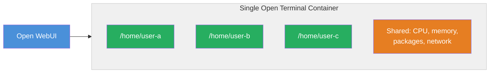
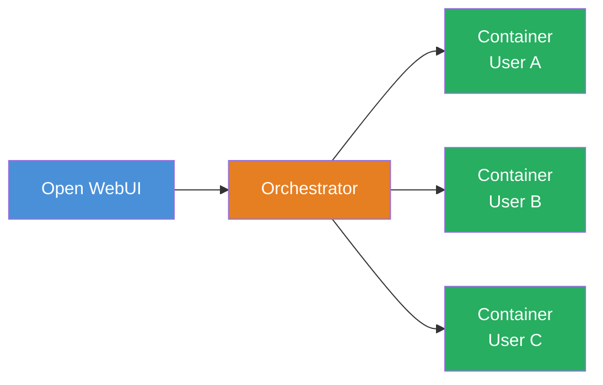

# 为团队配置 Open Terminal {#setting-up-open-terminal-for-a-team}

当你团队中的多人需要通过 Open WebUI 访问终端时，你有两种选择。

| | 单容器 | Terminals |
| :--- | :--- | :--- |
| **工作方式** | 单个容器中使用独立账户 | 每个用户、聊天或模型可以获得独立实例 |
| **隔离** | 在共享容器中使用独立工作区 | 每个用户、聊天或模型拥有独立实例及自己的文件、进程和资源。Docker 后端的容器共享一个网络 |
| **配置** | 一个额外设置 | 额外的编排服务 |
| **适用场景** | 成员之间彼此完全信任的小型团队 | 生产环境、较大团队、不受信任的用户 |
| **包含于** | Open Terminal（免费） | [Terminals](https://github.com/open-webui/terminals)（企业版） |

:::danger 多用户 Open WebUI 部署必读
如果你的 Open WebUI 实例**拥有不止一个用户账户**，并且同一个 terminal-server 连接被多个用户共享，那么你**必须**使用下面两种隔离模式之一。一个未设置 `OPEN_TERMINAL_MULTI_USER=true` 的单 Open Terminal 容器（或没有通过 Terminals 提供的每用户独立容器）会把所有用户放进同一个 shell、同一份文件系统、同一个网络命名空间——这意味着任何用户都能读取、修改或替换其他用户的文件，能以共享用户身份执行命令，还能绑定共享端口。这种配置在多用户 Open WebUI 中并不受支持。

**方式 1 隔离工作区。它不是用户之间的安全边界。** 所有人依然共享同一个内核、同一份进程列表、同一个网络命名空间和一套系统资源，而且在容器内配置每用户账户需要提升的权限，所以试图在容器内获得 root 的用户会成功。只在实例上的所有用户享有相同信任级别的场景中使用此模式。

对于**包含不可信用户**的部署（开放注册、对公网门户、用户之间不互相信任），请使用**方式 2（通过 Terminals 提供的每用户容器）**，在其 Kubernetes 后端上运行并添加 NetworkPolicy，这才是在用户之间建立真正边界的方案。在方式 1 之上叠加 `TERMINAL_PROXY_HEADERS` 会限制代理响应在用户浏览器中的能力，但容器内的任何事情都不会改变。
:::

---

## 方式 1：内置多用户模式 {#option-1-built-in-multi-user-mode}

最简单的方式。添加一个设置，每个人会自动获得独立的工作区。

```bash
docker run -d --name open-terminal -p 8000:8000 \
  -v open-terminal:/home \
  -e OPEN_TERMINAL_MULTI_USER=true \
  -e OPEN_TERMINAL_API_KEY=your-secret-key \
  ghcr.io/open-webui/open-terminal
```

{/* TODO: Screenshot: Docker run command in terminal with the MULTI_USER=true flag highlighted. */}

### 工作原理 {#what-happens}

当有人通过 Open WebUI 使用终端时，Open Terminal 会自动：

1. 根据该用户的 Open WebUI 用户 ID 为其创建个人账户
2. 在 `/home/{user-id}` 设置私有主目录
3. 在其自己的账户下运行所有命令
4. 将每个用户的文件保留在自己的文件夹中

每个用户在文件浏览器中只能看到自己的文件。

{/* TODO: Screenshot: Two views side by side: User A's file browser showing /home/user-a/ with their files, and User B's file browser showing /home/user-b/ with completely different files. */}

### 独立与共享的内容 {#whats-shared-vs-separate}

| | 每用户独立 | 共享 |
| :--- | :--- | :--- |
| 主目录和文件 | 是 | |
| 运行命令 | 是 | |
| 系统软件包 | | 是 |
| CPU 和内存 | | 是 |
| 网络访问 | | 是 |
| 进程列表和命令行 | | 是 |
| 系统状态和容器内的 root 权限 | | 是 |

:::warning 适合小团队，不适合生产环境
此模式给每个人提供独立的工作区，但所有人都运行在同一个容器内。资源压力（内存、CPU）是共享的。网络命名空间是共享的，所以一个用户绑定的端口（例如 `python -m http.server 8080`）可以从该容器上其他任何用户的 shell 访问。端口列表和端口代理的作用域限于拥有该端口的用户，因此端口不会出现在其他用户的文件导航器中，访问它需要从 shell 直接发起请求。进程列表是共享的，所以用户可以看到彼此运行的命令。容器内的 root 权限可以从任何账户访问到，因为首先配置这些账户本身就需要这些权限。

将一个实例上的所有用户视为同样信任，当用户需要彼此保护时使用下方的**方式 2（每用户独立容器）**的 Kubernetes 后端。在上面叠加 [`TERMINAL_PROXY_HEADERS`](/reference/env-configuration#terminal_proxy_headers) 配置可以在浏览器中将代理响应锁定在沙盒 CSP 中，值得做，但不会改变容器内发生的事情。
:::



---

## 方式 2：使用 Terminals 实现每用户独立容器 {#option-2-per-user-containers-with-terminals}

对于较大的部署或需要真正隔离的环境，[**Terminals**](../terminals/) 可为每位用户提供独立实例，其文件、进程和资源与其他用户隔离。

- **完整的实例隔离**：按用户分配独立实例时，每个实例拥有自己的文件、进程和资源
- **按需预配**：用户启动会话时创建实例，空闲后清理
- **资源控制**：在服务器上限内为各终端设定 CPU、内存和存储限制
- **多种环境**：拥有写入权限的用户可为不同团队（如数据科学、开发）创建不同配置的终端，再与用户和群组共享
- **后端**：Docker、Kubernetes 或 Kubernetes Operator
- **实例范围**：终端可为每位用户、已保存的聊天或模型运行一个实例，见[创建终端](/features/open-terminal/terminals/orchestration/creating-terminals#machine-scope)
- **Docker 后端网络**：设置 `TERMINALS_DOCKER_NETWORK` 后，各实例共享该 Docker 网络。编排器可按名称访问实例，一个实例也可访问另一个用户的实例所开放的端口。未设置时，编排器通过 Docker 宿主机上发布的端口访问实例。终端的**网络**设置可选择管理员在 `TERMINALS_NETWORK_PROFILES` 中定义的网络配置，从而将该终端放到另一个 Docker 网络。文件和进程依然分开。用户之间互不信任时，请使用 Kubernetes 后端并添加 NetworkPolicy



有三种部署后端：

- **[Docker 后端](../terminals/#deployment)** — 运行在单个 Docker 宿主机上。适合中小型团队或没有 Kubernetes 的环境。
- **Kubernetes**：编排器自行创建 Pod、卷和服务，无需 Operator 或 CRD。请设置 `TERMINALS_BACKEND=kubernetes`。
- **[Kubernetes Operator](../terminals/#deployment)** — 使用基于 CRD 的 Operator 进行生产级部署，通过 Helm chart 与 Open WebUI 一起部署。

:::info 需要企业许可证
Terminals 需要 [Open WebUI 企业许可证](/enterprise)。许可证详情请参阅 [Terminals 仓库](https://github.com/open-webui/terminals)。
:::

## 相关链接 {#related}

- [Terminals 概述 →](../terminals/)
- [Terminals：Docker 后端 →](../terminals/#deployment)
- [Terminals：Kubernetes Operator →](../terminals/#deployment)
- [安全最佳实践 →](./security.md)
- [所有配置选项 →](./configuration.md)
