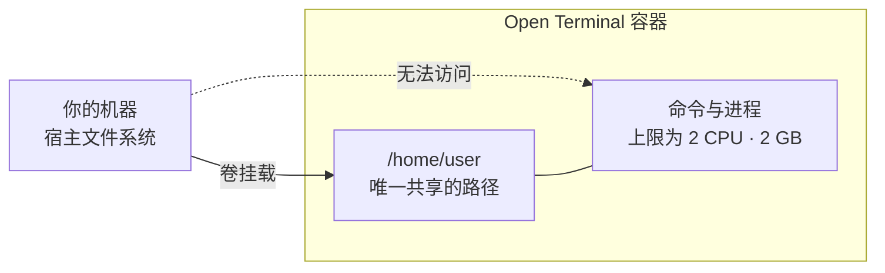
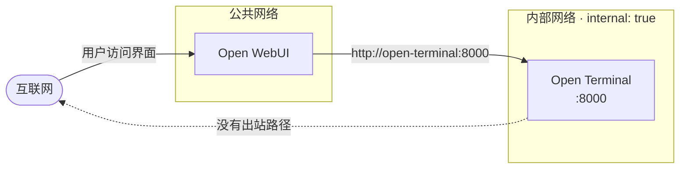
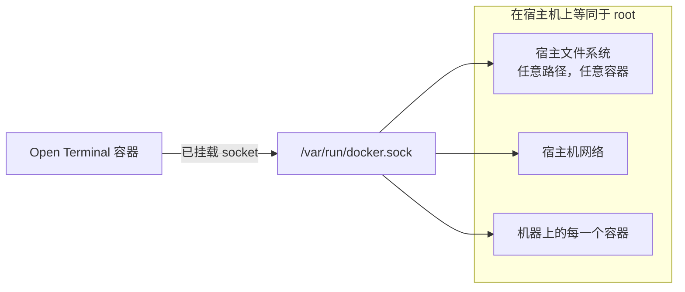

# 安全最佳实践 {#security-best-practices}

Open Terminal 赋予 AI 运行命令和管理文件的真实能力。以下是确保这种能力被安全使用的方法。

---

## 使用 Docker {#use-docker}

**始终使用 Docker**，除非你明确需要直接访问你的机器。Docker 将 Open Terminal 隔离在自己的容器中：它有自己的文件系统、自己的进程，除非你明确允许，否则无法访问宿主计算机上的任何内容。

```bash
docker run -d --name open-terminal -p 8000:8000 \
  --memory 2g --cpus 2 \
  -v open-terminal:/home/user \
  -e OPEN_TERMINAL_API_KEY=your-secret-key \
  ghcr.io/open-webui/open-terminal
```

`--memory 2g` 和 `--cpus 2` 标志可防止失控进程消耗你机器的全部资源。



容器只会触及你机器上的一个路径，也就是你挂载的那个卷。宿主文件系统上的其他一切都在它之外，而资源标志则可以防止失控进程把整台机器拖垮。

:::warning 不使用 Docker 运行
不使用 Docker（裸机模式）时，AI 可以使用你用户账户的权限运行任何命令——包括删除文件、安装软件，或访问你账户能访问的任何内容。裸机模式仅用于你自己的个人机器上的个人项目。
:::

---

## 始终设置密码 {#always-set-a-password}

API Key 控制所有访问权限：任何能访问该端口并提供密钥的人都可以运行命令、读取文件并控制终端。服务器在没有密钥的情况下拒绝启动：直接运行 `uvicorn` 需要设置 `OPEN_TERMINAL_API_KEY`，CLI 会在你未提供时为你生成一个。请设置一个自己的强密钥，而不是依赖自动生成的密钥。

```bash
-e OPEN_TERMINAL_API_KEY=a-strong-password-here
```

在生产环境中，请使用[配置文件](./configuration.md#config-file)或 [Docker secrets](./configuration.md#docker-secrets)，而不是在命令行中明文传入密钥。

未提供密钥时，服务器会生成一个并在启动时打印出来：

```bash
docker logs open-terminal
```

```
  Local:    http://localhost:8000
  Network:  http://172.17.0.2:8000

  API Key:  <auto-generated key appears here>
```

请把生成的这个值当作起点，而不是密码。用你自己的强密钥替换它，并在生产环境中让它不出现在命令行上。

---

## 使用管理员连接（而非用户连接） {#use-admin-connections-not-user-connections}

连接到 Open WebUI 时，优先使用**管理员配置**方式：

| | 管理员配置 | 用户配置 |
| :--- | :--- | :--- |
| API Key 可见性 | 保存在服务端，不对用户暴露 | 存储在用户浏览器中 |
| 请求经过 | Open WebUI 后端 | 直接从浏览器发出 |
| 终端网络访问来源 | 仅 Open WebUI 服务器 | 每位用户的计算机 |

管理员配置的连接可防止 API Key 进入用户浏览器，并让你控制谁有访问权限。


---

## 限制资源 {#limit-resources}

防止失控脚本消耗所有可用的 CPU 和内存：

```yaml title="docker-compose.yml"
deploy:
  resources:
    limits:
      memory: 2G
      cpus: "2.0"
```

如果进程超出这些限制，Docker 会对其进行限流（CPU）或终止（内存）。你的服务器保持健康运行。

用 `docker stats` 查看容器实际的使用情况：

```bash
docker stats --no-stream open-terminal
```

```
NAME             CPU %     MEM USAGE / LIMIT   MEM %
open-terminal    0.04%     67.57MiB / 2GiB     3.30%
```

LIMIT 一列反映的就是你设置的标志，因此你可以确认上限确实生效，而不必想当然。

---

## 网络隔离 {#network-isolation}

对于最安全的配置，将 Open Terminal 放置在只有 Open WebUI 能访问的**私有 Docker 网络**中：

```yaml title="docker-compose.yml"
services:
  open-webui:
    image: ghcr.io/open-webui/open-webui:latest
    ports:
      - "3000:8080"
    networks:
      - public
      - internal

  open-terminal:
    image: ghcr.io/open-webui/open-terminal
    # Notice: no ports exposed to the outside
    networks:
      - internal

networks:
  public:
  internal:
    internal: true   # No internet access from this network
```

这意味着：
- Open WebUI 可以通过 `http://open-terminal:8000` 访问 Open Terminal
- Open Terminal **无法**从互联网直接访问
- Open Terminal **无法发出出站互联网请求**



Open WebUI 同时位于两个网络之上，因此既能为用户提供服务，又能访问终端。终端只位于内部网络，这正是互联网上的任何东西都无法访问它、它也无法向外发起调用的原因。

---

## 出站流量过滤 {#egress-filtering}

如果 Open Terminal 需要*一定的*互联网访问权限（例如安装软件包），你可以将其限制在特定域名：

```bash
-e OPEN_TERMINAL_ALLOWED_DOMAINS="pypi.org,github.com,*.npmjs.org"
```

只有这些域名可以访问。其他所有域名均被阻止。这可以防止：
- 未经授权的数据离开容器
- 下载意外的软件
- 访问你未预期的内部服务

启动时，服务器会确认它解析了哪些域名以及防火墙是否已启用：

```
Egress: DNS whitelist — pypi.org,github.com
  ✓ pypi.org (+ subdomains)
  ✓ github.com (+ subdomains)
dnsmasq started (upstream: 1.1.1.1)
Egress firewall active — dropping CAP_NET_ADMIN permanently
```

在容器内部，允许的主机可以解析，被阻止的主机则不能：

```bash
curl https://github.com/        # allowed by the list above
curl https://example.com/       # not on the list, DNS resolution fails
```

:::note 需要额外的 capability
出站过滤会在容器内配置 `dnsmasq` 和 `iptables`，因此需要 `--cap-add NET_ADMIN`。在那些容器之后无法再丢弃 `CAP_NET_ADMIN` 的主机上，服务会在启动时以 `unable to raise CAP_SETPCAP for BSET changes` 退出。如果遇到这种情况，请先检查主机的 seccomp 与 capability 设置，再依赖此模式。
:::

---

## Docker socket 警告 {#docker-socket-warning}

Docker 容器可以选择性地访问宿主机的 Docker（让 AI 构建镜像、运行容器等）：

```bash
-v /var/run/docker.sock:/var/run/docker.sock
```

:::danger 仅限可信环境
挂载 Docker socket 等同于给予容器对你宿主机 Docker 的**完全控制权**。这实际上就是你这台机器上的 root 权限。任何拥有终端访问权限的人都可以：
- 运行挂载你整个文件系统的容器
- 访问你的宿主机网络
- 管理你机器上的每一个容器

只有当你完全信任每一位拥有终端访问权限的人时，才可以这样做。
:::



挂载 socket 并不是一项范围很窄的权限。它把你在 Docker 上的控制权原样交给了容器，这正是建议只在完全信任所有能访问终端的人时才这样做的原因。

---

## 端口预览运行在沙箱中 {#port-previews-run-sandboxed}

当 agent 启动一个服务器时，[浏览器标签页](../use-cases/web-development.md#the-browser-tab)会在一个沙箱化的框架中显示它。脚本、表单、弹窗、模态框和下载都是允许的，因此普通应用可以正常工作；但默认情况下，该框架被视为与 Open WebUI 相互独立的源，这让终端中运行的东西与你的会话隔离开来。

**Settings > Interface > Terminal Preview Allow Same Origin** 可以放宽这一限制，默认是关闭的，只有你主动开启才会生效。仅当你编写并信任的某个东西确实需要同源浏览器 API（例如存储或 cookie）时才打开它，并记住正在预览的代码往往正是 agent 刚刚写出来的代码。

## 多用户模式是工作区级别的拆分 {#multi-user-mode-is-a-workspace-split}

`OPEN_TERMINAL_MULTI_USER=true` 会让每个 Open WebUI 用户在同一个容器内拥有各自独立的 Linux 账户和主目录，从而在工作时把人们及其 agent 隔离开，不去翻对方的文件。但所有人仍然共享同一个内核、进程列表、网络命名空间和系统，而且配置这些账户需要在容器内具备提升的权限，因此其中的 root 对任何账户来说都是触手可及的。只在实例上的每位用户都受到同等信任的环境里运行它。

当用户之间需要相互隔离时，请为每个人提供独立的容器，参见[终端](../terminals/)。两种方案的并列对比请参阅[多用户设置](./multi-user.md)。

---

## 安全检查清单 {#security-checklist}

- [ ] 使用 Docker 而非裸机
- [ ] 设置强壮的 API Key
- [ ] 使用管理员配置的连接
- [ ] 设置内存和 CPU 限制
- [ ] 使用网络隔离（内部 Docker 网络）
- [ ] 在不需要互联网访问时启用出站过滤
- [ ] 除非必要，否则不要挂载 Docker socket
- [ ] 如果不需要运行时安装软件包，请使用 `slim` 或 `alpine` 镜像
- [ ] 除非预览确实需要，否则保持 **Terminal Preview Allow Same Origin** 关闭
- [ ] 当用户之间需要相互保护时，为每位用户提供独立的容器

## 相关链接 {#related}

- [所有配置选项 →](./configuration.md)
- [多用户设置 →](./multi-user.md)
