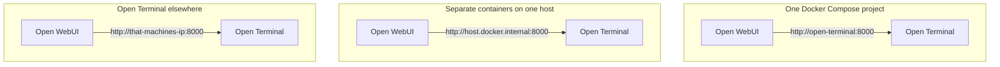

# 将 Open Terminal 连接到 Open WebUI {#connecting-open-terminal-to-open-webui}

Open Terminal 已[安装并运行](./installation.mdx)。本指南介绍如何将其连接到 Open WebUI。

要让 Open WebUI 在服务器或笔记本电脑上为你安装 Open Terminal，参见 [SSH 机器](./ssh-machines.md)。要在运行 Open WebUI 的服务器上安装，参见[本地机器](./local-machine.md)。

---

## 推荐方式：管理设置 {#recommended-admin-settings}

适用于所有部署场景，包括单用户场景。管理员连接可将 API Key 保存在服务端。

### 1. 打开 Settings {#1-open-settings}

点击左侧边栏底部的**你的名字**，打开用户菜单，然后点击 **Settings**。


### 2. 进入 Settings > Integrations（管理员区域） {#2-go-to-settings--integrations-admin-section}

在设置侧边栏中找到 **Admin** 区域，然后点击 **Integrations**。


### 3. 找到 "Open Terminal" 区域 {#3-find-the-open-terminal-section}

向下滚动到包含 **Open Terminal** 连接的**机器**区域。如果 [`ENABLE_TOOL_SERVERS`](/reference/env-configuration#enable_tool_servers) 设为 `False`，该区域会呈灰色。


:::warning 不要与 "Tools" 混淆
在**机器**区域添加 Open Terminal。**外部工具服务器**下的**工具**区域不适用。只有**机器**区域提供内置文件浏览器和终端侧边栏。
:::

### 4. 点击 + 并填写详情 {#4-click--and-fill-in-the-details}

| 字段 | 填写内容 |
| :--- | :--- |
| **URL** | `http://localhost:8000`（使用 Docker Compose 时为 `http://open-terminal:8000`） |
| **API Key** | 安装时设置的密码 |
| **Auth** | 保持默认的 `Bearer`。[Auth](#auth) 说明其他选项为何会破坏交互式终端 |
| **Chat Uploads** | 新连接默认为 `Filesystem`。参见 [Chat Uploads](#chat-uploads) 了解各选项的行为 |
| **Working Directory Context** | 位于 **Advanced** 下，默认开启。[Working Directory Context](#working-directory-context) 一节说明何时应将其关闭 |
| **User Shell Tools** | 位于 **Advanced** 下。保持 `Automatic`。[User Shell Tools](#user-shell-tools) 一节说明 `Always Include` 会带来哪些变化 |
| **转发 cookie** | 位于**高级**下，默认关闭。仅在机器使用 cookie 认证时才开启，因为浏览器针对你的 Open WebUI 域保存的每个 cookie 都会随请求发送 |


### 5. 保存 {#5-save}

点击**保存**。连接会出现在 **Open Terminal** 下，且其开关处于打开状态。


### 6.（可选）限制特定组的访问 {#6-optional-restrict-access-to-specific-groups}

通过访问控制按钮将访问权限限制在特定用户组。


:::tip 编排器连接可以进一步限定范围
[Terminals 编排器](/features/open-terminal/terminals/)连接提供**读取**和**写入**权限。拥有**写入**权限的用户可以从消息输入框中的机器菜单创建自己的机器，每台机器都有自己的镜像、资源、环境变量和共享设置。参见[创建机器](/features/open-terminal/terminals/orchestration/creating-terminals)。直连 Open Terminal 时无需创建机器，所有有访问权限的人均可使用。
:::

### 7. 在聊天中选择机器 {#7-select-a-machine-in-chat}

在聊天输入区域点击云图标。你的机器会显示在**机器**下。选择一台，即可在当前对话中启用。


所选机器的名称会显示在云图标旁。AI 现在可以通过它执行命令、读取文件并运行代码。除正在生成回复时外，你可以随时选择其他机器。

将指针悬停在菜单中的机器上，点击**更多**并选择**系统信息**，可查看它报告的 CPU、内存、磁盘和网络使用情况、运行时长及主要进程。视图打开时每 5 秒刷新一次。对于每个聊天使用独立实例的机器，**系统信息**会在聊天保存后显示。

### 8. 启用原生函数调用 {#8-enable-native-function-calling}

原生函数调用是默认的工具调用模式，因此新模型已经启用了它。唯一需要确认的是模型没有被切换到 **Legacy**：

1. 进入 **Workspace → Models**
2. 点击你正在使用的模型的编辑按钮
3. 确认 **Function Calling** 设置为 **Default** 或 **Native**，而不是 **Legacy**
4. 保存


:::warning Legacy 模式对工具而言可靠性较低
如果模型被设置为 **Legacy**，Open WebUI 会回退到基于提示词的工具调用，而不是提供商的结构化工具调用格式。这种方式可靠性较低，甚至可能根本无法触发终端命令。推荐使用 Native（默认值）。
:::

:::tip 性能取决于所用模型
并非所有模型在工具方面的能力都相同。多步骤终端工作流是 Open WebUI 中要求最高的 agentic 用例，因此这里是顶级模型真正体现价值的地方：GPT-5.6 Sol、Claude Opus 5 或 Gemini 3.5 Pro。当前的中间档模型（GPT-5.6 Terra、Claude Sonnet 5、Gemini 3.6 Flash、MiniMax M3）则是切实可行的**最低要求**。较旧或很小的模型可能无法调用工具，或产生格式错误的工具调用。如果效果不佳，请尝试能力更强的模型。
:::

### 9. 测试一下 {#9-try-it-out}

向 AI 提问，例如：

> "你运行的是什么操作系统？"

AI 应该会使用 Open Terminal 运行一条命令，然后告诉你答案。


:::tip 通过环境变量预配置
对于 Docker 部署，可以使用环境变量 [`MACHINE_CONNECTIONS`](/reference/env-configuration#machine_connections) 自动配置机器，适用于希望在启动时自动完成配置的场景。
:::

---

## 自己的机器（Tether） {#your-own-machine-tether}

没有管理员权限时，请在 Tether 应用中添加机器。机器仅供你使用，URL 和密钥保存在你的电脑上。参见[自带模型和工具](/ecosystem/tether#bring-your-own-models-and-tools)。

---

## 认证 {#auth}

连接表单上的 **Auth** 决定 Open WebUI 以什么凭据向终端服务器发送请求。模型的工具以及文件浏览器的列表、读取和上传走 HTTP。**New Terminal** 标签页中的 shell、文件浏览器的实时刷新与监听端口、**Desktop** 标签页以及运行中命令的流式输出走 websocket。两条路径发送的内容不同：

| Auth | HTTP 请求 | Websocket 连接 |
| :--- | :--- | :--- |
| `Bearer` | 把 **API Key** 作为 bearer 令牌 | **API Key** |
| `None` | 不带密钥 | 空令牌 |
| `Session` | 把用户自己的 Open WebUI 令牌作为 bearer 令牌 | 空令牌 |
| `OAuth` | 当用户有 OAuth 登录会话时，把其 OAuth 访问令牌作为 bearer 令牌 | 空令牌 |

`Bearer` 是唯一会发送 **API Key** 的选项，也是唯一能为两条路径都完成认证的选项。使用 `Session` 或 `OAuth` 时，模型的工具和文件浏览器可以对接受该令牌的终端服务器工作，但所有 websocket 功能都会带着空令牌访问服务器。这些功能只有在终端服务器允许无密钥连接时才可用。Open Terminal 是带 API key 配置的，因此请为它保留 `Bearer`。

通过[终端编排器](/features/open-terminal/terminals/)连接创建的终端，无论 **Auth** 如何设置，都始终使用该连接的 **API Key** 和 `Bearer`。

---

## 聊天上传 {#chat-uploads}

连接表单上的**聊天上传**控制选定该机器时，聊天输入框中附加的文件发送到哪里。

`Default` 会将文件上传到 Open WebUI，提取文本，并依据聊天设置将检索结果或全文交给模型。完全未选择机器时也使用此方式。

新机器默认使用 `Filesystem`，[Tether](/ecosystem/tether) 机器始终使用此选项。

`Filesystem` 将文件写入机器的工作目录、[文件浏览器](../file-browser.md)已打开的文件夹或机器当前工作目录。文件会立即显示在那里。Open WebUI 不存储文件、不提取文本，也不执行检索，因此模型不会直接收到文件内容。模型会收到路径，并使用机器自己的工具打开文件，与读取工作区中的其他文件相同。

zip 压缩包、SQLite 数据库、视频文件、远超上下文窗口的导出文件：对它们中的任何一种，文本提取能提供的东西都很有限，而 shell 都能处理。以这种方式附加文件，就是把它放到模型所运行的命令能够触及的位置。

使用它会改变四件事：

- **模型不需要支持文件上传。** 使用 `Default` 时，在选中了不具备该能力的模型的情况下附加文件，会提示 "Model(s) do not support file upload" 且不会上传任何内容。使用 `Filesystem` 时，文件根本不会作为附件到达模型，因此这项检查不会执行。
- **只有在模型能据此行动时，路径才会告知模型。** 在已保存的对话中且模型使用原生函数调用时，Open WebUI 会把附加文件的路径与消息一并传给模型。把模型设为 [Legacy](#8-enable-native-function-calling) 函数调用，或关闭其 **Builtin Tools** 能力，文件仍会到达终端，但模型将不知道它的位置。
- **图片的处理方式相同。** 附加到已保存对话中的图片会被写入工作目录，而不是作为图片传给模型。Open WebUI 仍会先检查所选模型是否支持图像，因此不支持视觉的模型会在输入阶段将其拒绝。
- **上传限制依然生效。** 为 Open WebUI 配置的最大文件大小和最大附件数量在发送任何内容之前都会被检查，因此 `Filesystem` 并不会取消这些限制。

对[每个聊天使用独立实例](/features/open-terminal/terminals/orchestration/creating-terminals#machine-scope)的机器，发送新聊天的第一条消息时，该消息中的附件会上传到该聊天的实例。

管理员添加的每台机器都有此字段。[Tether](/ecosystem/tether) 机器始终使用 **Filesystem**。


---

## 工作目录上下文 {#working-directory-context}

**Working Directory Context** 位于管理员添加的连接的 **Advanced** 下，默认开启。在它开启时，Open WebUI 会在每条消息上向终端询问其当前工作目录，并把它写入命令工具的说明中，这样模型就知道自己的命令在哪里运行。

工具说明属于每个请求缓存前缀的一部分，因此每次目录变化都会让提供商的[提示词缓存](/features/chat-conversations/prompt-caching)重新开始。关闭该开关可以让说明在消息之间保持一致。

## 用户 Shell 工具 {#user-shell-tools}

**Tabs** 的 **+** 菜单中的 **New Terminal** 标签页是你自己的 shell。有两个工具让模型能够读取该 shell 最近的输出并向它发送输入。位于 **Advanced** 下的 **User Shell Tools** 决定模型何时获得这两个工具：

- `Automatic`（默认）：仅在你发送消息的聊天中，该机器的 Shell 已打开时生效。每次发送消息前，Open WebUI 都会询问终端服务器它是否已打开。
- `Always Include`：无论 shell 是否打开，每条消息都提供。工具列表在消息之间保持不变，这样在你打开和关闭 shell 时[提示词缓存](/features/chat-conversations/prompt-caching)仍然有效。

自动化和子智能体始终无法使用这两项工具。管理员添加的每台机器都有此字段。[Tether](/ecosystem/tether) 机器始终使用 **Automatic**。

## AGENTS.md 工作区指令 {#agentsmd}

在聊天中选中某个终端时，Open WebUI 会在每条消息上读取该终端用户主目录中的 `AGENTS.md`。其内容会在第一条用户消息之前紧接着以一条用户消息的形式加入对话，因此模型能得到你为该工作区设定的常驻指令。对该文件的修改从下一条消息开始生效。Windows 的主目录同样适用。

超过 32 KiB 的文件和读取用时超过 5 秒的文件都会被跳过。管理员配置的机器由 Open WebUI 服务器读取，用户在 Tether 应用中添加的机器则由 Tether 读取，因此 Tether 应用必须保持连接。

---

## 故障排除 {#troubleshooting}

### "连接失败"或超时 {#connection-failed-or-timeout}

这几乎总是意味着 Open WebUI 无法通过网络访问 Open Terminal。使用哪个 URL 取决于你的配置：

| 你的配置 | 使用的 URL |
| :--- | :--- |
| Docker Compose（推荐） | `http://open-terminal:8000` |
| 独立 Docker 容器 | `http://host.docker.internal:8000` |
| 同一机器，无 Docker | `http://localhost:8000` |
| Open Terminal 在另一台机器上 | `http://that-machines-ip:8000` |



Compose 为容器提供了共享网络并解析服务名，因此服务名就是地址。独立容器没有可解析的共享名称，所以请求会绕经主机重新发出。位于另一台机器上的终端则像访问其他任何主机一样访问。

只有当两边都没有容器化时 `localhost` 才有效，因为在容器内部，`localhost` 指的是该容器本身，而不是它所运行的机器。这正是本节所讨论的超时最常见的原因。

:::tip 快速检查
运行以下命令查看 Open WebUI 是否能访问 Open Terminal：

```bash
docker exec open-webui curl -s http://open-terminal:8000/health
```

如果输出 `{"status": "ok"}`，说明连接正常。如果报错，说明两个容器之间无法互相访问。
:::

### 机器已显示，但 AI 未使用它 {#machine-shows-up-but-ai-doesnt-use-it}

请确认：
- 连接旁的开关应当**开启**。关闭后，机器会完全停止提供服务：模型无法获得它的工具，终端和文件浏览器会拒绝连接，代理到该机器的请求也会被拒绝。这个开关可实际停用机器，因此你可以用它下线机器，无需删除连接。
- 添加连接后已**刷新页面**
- 你的模型支持工具调用（大多数现代模型都支持）

### 选择器中缺少机器 {#machine-is-missing-from-the-picker}

仅列出用户获准使用的机器，请检查连接的访问授权，以及该连接是否启用。

对于编排器连接，只有机器共享给你，或你对连接拥有**写入**权限时，才会列出机器。每个聊天使用独立实例的机器需要已保存的对话，因此在临时聊天中隐藏。参见[创建机器](/features/open-terminal/terminals/orchestration/creating-terminals#machine-scope)。

### 命令输出为空 {#command-output-is-empty}

`run_command` 的结果显示 `"status": "running"` 和空的 `output` 列表。`run_command` 会在后台启动命令并立即返回其命令 ID。只有当调用发送了 `wait` 值（最长 `300` 秒）或服务器设置了 `OPEN_TERMINAL_EXECUTE_TIMEOUT`（默认未设置）时，它才会等待命令结束。模型稍后用该 ID 调用 `get_process_status` 读取输出，该调用同样接受 `wait`。

若想在第一次结果中就拿到短命令的输出，请在 Open Terminal 服务器上设置 `OPEN_TERMINAL_EXECUTE_TIMEOUT`，例如 `OPEN_TERMINAL_EXECUTE_TIMEOUT=5`，并重启它。更早结束的命令会在结束时立即返回。运行更久的命令仍会返回状态 `running`，其输出要通过 `get_process_status` 获取。参见[配置](/features/open-terminal/advanced/configuration)。

### 多用户模式下文件浏览器显示 Permission denied {#file-browser-shows-permission-denied-in-multi-user-mode}

如果机器以[多用户模式](/features/open-terminal/advanced/multi-user)运行，文件浏览器报 `403` 和 `Permission denied`，但模型仍可读取文件，请检查 `/home` 的存储位置。参见[网络存储上的主目录](/features/open-terminal/advanced/multi-user#home-folders-on-network-storage)。

### API Key 错误 {#wrong-api-key}

如果看到"unauthorized"或"invalid key"：
- 仔细核对密钥是否与安装时设置的一致
- 如果忘记了，请运行 `docker logs open-terminal`，查找 `API Key:` 所在的行

## 后续步骤 {#next-steps}

- **[代码执行](../use-cases/code-execution.md)**
- **[文档与数据分析](../use-cases/file-analysis.md)**
- **[软件开发](../use-cases/software-development.md)**
- **[文件浏览器](../file-browser.md)**
