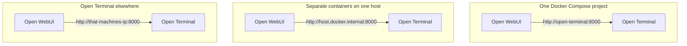

# 将 Open Terminal 连接到 Open WebUI {#connecting-open-terminal-to-open-webui}

Open Terminal 已[安装并运行](./installation.mdx)。本指南介绍如何将其连接到 Open WebUI。

---

## 推荐方式：管理设置 {#recommended-admin-settings}

适用于所有部署场景，包括单用户场景。管理员连接可将 API Key 保存在服务端。

### 1. 打开 Settings {#1-open-settings}

点击左侧边栏底部的**你的名字**，打开用户菜单，然后点击 **Settings**。


### 2. 进入 Settings > Integrations（管理员区域） {#2-go-to-settings--integrations-admin-section}

在设置侧边栏中找到 **Admin** 区域，然后点击 **Integrations**。


### 3. 找到 "Open Terminal" 区域 {#3-find-the-open-terminal-section}

向下滚动，直到看到带有 **Open Terminal** 连接的 **Terminal** 区域。当 [`ENABLE_TOOL_SERVERS`](/reference/env-configuration#enable_tool_servers) 设置为 `False` 时，该区域会显示为灰色。


:::warning 不要与 "Tools" 混淆
Open Terminal 在 Integrations 下有**独立的区域**——不要将它添加到 "External Tools" 或 "Tool Servers" 下。使用专属区域才能获得内置的文件浏览器和终端侧边栏。
:::

### 4. 点击 + 并填写详情 {#4-click--and-fill-in-the-details}

| 字段 | 填写内容 |
| :--- | :--- |
| **URL** | `http://localhost:8000`（使用 Docker Compose 时为 `http://open-terminal:8000`） |
| **API Key** | 安装时设置的密码 |
| **Auth** | 保持默认的 `Bearer` |
| **Chat Uploads** | 新连接默认为 `Filesystem`。参见 [Chat Uploads](#chat-uploads) 了解各选项的行为 |
| **Working Directory Context** | 位于 **Advanced** 下，默认开启。[Working Directory Context](#working-directory-context) 一节说明何时应将其关闭 |
| **User Shell Tools** | 位于 **Advanced** 下。保持 `Automatic`。[User Shell Tools](#user-shell-tools) 一节说明 `Always Include` 会带来哪些变化 |
| **Forward cookies** | 位于 **Advanced** 下，默认关闭。仅当终端服务器通过 cookie 认证时才应开启，因为浏览器为你的 Open WebUI 域持有的每一个 cookie 都会随请求一同发送 |


### 5. 保存 {#5-save}

点击**保存**。连接会出现在 **Open Terminal** 下，且其开关处于打开状态。


### 6.（可选）限制特定组的访问 {#6-optional-restrict-access-to-specific-groups}

通过访问控制按钮，将终端访问限制到特定用户组。


:::tip 编排器连接可以进一步限定范围
[Terminals 编排器](/features/open-terminal/terminals/)连接提供 **Read** 和 **Write** 权限。拥有 **Write** 权限的用户可从消息输入框中的终端菜单创建自己的终端，并分别配置镜像、资源、环境变量和共享权限。参见[创建终端](/features/open-terminal/terminals/orchestration/creating-terminals)。直接连接 Open Terminal 时无需创建终端，所有有权访问该连接的人都能使用。
:::

### 7. 在聊天中选择终端 {#7-select-a-terminal-in-chat}

在聊天输入区域点击**终端按钮**（云图标）。你的终端会显示在 **Terminals** 下。选择一个即可在当前对话中启用。


所选终端名称会显示在云图标旁边。AI 现在可以通过它执行命令、读取文件和运行代码。除正在生成回复时外，你可以随时切换到其他终端。

将指针停在菜单中的终端上，点击 **System info** 按钮，即可查看服务器上报的 CPU、内存、磁盘和网络用量、运行时长及资源占用最高的进程。此视图打开时每 5 秒刷新一次。对于每个聊天使用独立实例的终端，该按钮会在聊天保存后出现。

### 8. 启用原生函数调用 {#8-enable-native-function-calling}

原生函数调用是默认的工具调用模式，因此新模型已经启用了它。唯一需要确认的是模型没有被切换到 **Legacy**：

1. 进入 **Workspace → Models**
2. 点击你正在使用的模型的编辑按钮
3. 确认 **Function Calling** 设置为 **Native**（默认值），而不是 **Legacy**
4. 保存


:::warning Legacy 模式对工具而言可靠性较低
如果模型被设置为 **Legacy**，Open WebUI 会回退到基于提示词的工具调用，而不是提供商的结构化工具调用格式。这种方式可靠性较低，甚至可能根本无法触发终端命令。推荐使用 Native（默认值）。
:::

:::tip 性能取决于所用模型
并非所有模型在工具方面的能力都相同。多步骤终端工作流是 Open WebUI 中要求最高的 agentic 用例，因此这里是顶级模型真正体现价值的地方：GPT-5.6 Sol、Claude Opus 5 或 Gemini 3.5 Pro。当前的中间档模型（GPT-5.6 Terra、Claude Sonnet 5、Gemini 3.6 Flash、MiniMax M3）则是切实可行的**最低要求**。较旧或很小的模型可能无法调用工具，或产生格式错误的工具调用。如果效果不佳，请尝试能力更强的模型。
:::

### 9. 测试一下 {#9-try-it-out}

向 AI 提问，例如：

> "你运行的是什么操作系统？"

AI 应该会使用 Open Terminal 运行一条命令，然后告诉你答案。


:::tip 通过环境变量预配置
对于 Docker 部署，可以使用 `TERMINAL_SERVER_CONNECTIONS` 环境变量自动配置终端连接——适用于希望在启动时就完成全部配置而无需手动操作的场景。
:::

---

## 自己的终端（Tether） {#your-own-terminal-tether}

没有管理员权限时，可在 Tether 应用中添加终端。该终端仅供你自己使用，URL 和密钥保存在你的电脑上。参见[自带模型与工具](/ecosystem/tether#bring-your-own-models-and-tools)。

---

## 聊天上传 {#chat-uploads}

连接表单上的 **Chat Uploads** 决定：在选中该终端时，聊天输入框中附加的文件会放到哪里。

`Default` 会将文件上传到 Open WebUI，提取文本，再根据聊天设置通过检索或全文传入的方式将内容交给模型。未选择终端时也采用这种方式。

新终端连接默认使用 `Filesystem`，[Tether](/ecosystem/tether) 终端始终使用此选项。

`Filesystem` 会将文件写入终端的工作文件夹、[文件浏览器](../file-browser.md)打开的文件夹或终端当前的工作目录，文件会立即出现在那里。Open WebUI 不存储该文件，也不提取文本或运行检索，因此模型不会直接收到文件内容。模型收到的是路径，并使用终端自带的工具打开文件，方式与读取工作区中的其他文件相同。

zip 压缩包、SQLite 数据库、视频文件、远超上下文窗口的导出文件：对它们中的任何一种，文本提取能提供的东西都很有限，而 shell 都能处理。以这种方式附加文件，就是把它放到模型所运行的命令能够触及的位置。

使用它会改变四件事：

- **模型不需要支持文件上传。** 使用 `Default` 时，在选中了不具备该能力的模型的情况下附加文件，会提示 "Model(s) do not support file upload" 且不会上传任何内容。使用 `Filesystem` 时，文件根本不会作为附件到达模型，因此这项检查不会执行。
- **只有在模型能据此行动时，路径才会告知模型。** 在已保存的对话中且模型使用原生函数调用时，Open WebUI 会把附加文件的路径与消息一并传给模型。把模型设为 [Legacy](#8-enable-native-function-calling) 函数调用，或关闭其 **Builtin Tools** 能力，文件仍会到达终端，但模型将不知道它的位置。
- **图片的处理方式相同。** 附加到已保存对话中的图片会被写入工作目录，而不是作为图片传给模型。Open WebUI 仍会先检查所选模型是否支持图像，因此不支持视觉的模型会在输入阶段将其拒绝。
- **上传限制依然生效。** 为 Open WebUI 配置的最大文件大小和最大附件数量在发送任何内容之前都会被检查，因此 `Filesystem` 并不会取消这些限制。

对[每个聊天使用独立实例](/features/open-terminal/terminals/orchestration/creating-terminals#machine-scope)的终端，发送新聊天的第一条消息时，其中的附件会上传到该聊天的实例。

管理员添加的每个终端连接都有此字段。[Tether](/ecosystem/tether) 终端始终使用 **Filesystem**。


---

## 工作目录上下文 {#working-directory-context}

**Working Directory Context** 位于管理员添加的连接的 **Advanced** 下，默认开启。在它开启时，Open WebUI 会在每条消息上向终端询问其当前工作目录，并把它写入命令工具的说明中，这样模型就知道自己的命令在哪里运行。

工具说明属于每个请求缓存前缀的一部分，因此每次目录变化都会让提供商的[提示词缓存](/features/chat-conversations/prompt-caching)重新开始。关闭该开关可以让说明在消息之间保持一致。

## 用户 Shell 工具 {#user-shell-tools}

**Tabs** 的 **+** 菜单中的 **New Terminal** 标签页是你自己的 shell。有两个工具让模型能够读取该 shell 最近的输出并向它发送输入。位于 **Advanced** 下的 **User Shell Tools** 决定模型何时获得这两个工具：

- `Automatic`（默认）：仅当你正在发送消息的那个聊天中、该终端的 shell 处于打开状态时。每条消息之前，Open WebUI 都会询问你的浏览器它是否打开。
- `Always Include`：无论 shell 是否打开，每条消息都提供。工具列表在消息之间保持不变，这样在你打开和关闭 shell 时[提示词缓存](/features/chat-conversations/prompt-caching)仍然有效。

自动化和子智能体始终无法使用这两项工具。管理员添加的每个终端连接都有此字段。[Tether](/ecosystem/tether) 终端始终使用 **Automatic**。

## AGENTS.md 工作区指令 {#agentsmd}

在聊天中选中某个终端时，Open WebUI 会在每条消息上读取该终端用户主目录中的 `AGENTS.md`。其内容会在第一条用户消息之前紧接着以一条用户消息的形式加入对话，因此模型能得到你为该工作区设定的常驻指令。对该文件的修改从下一条消息开始生效。Windows 的主目录同样适用。

超过 32 KiB 的文件以及读取用时超过 5 秒的文件都会被跳过。对于管理员配置的终端，由 Open WebUI 服务器读取文件。对于用户在 Tether 应用中添加的终端，由 Tether 读取文件，因此须让 Tether 应用保持连接。

---

## 故障排除 {#troubleshooting}

### "连接失败"或超时 {#connection-failed-or-timeout}

这几乎总是意味着 Open WebUI 无法通过网络访问 Open Terminal。使用哪个 URL 取决于你的配置：

| 你的配置 | 使用的 URL |
| :--- | :--- |
| Docker Compose（推荐） | `http://open-terminal:8000` |
| 独立 Docker 容器 | `http://host.docker.internal:8000` |
| 同一机器，无 Docker | `http://localhost:8000` |
| Open Terminal 在另一台机器上 | `http://that-machines-ip:8000` |



Compose 为容器提供了共享网络并解析服务名，因此服务名就是地址。独立容器没有可解析的共享名称，所以请求会绕经主机重新发出。位于另一台机器上的终端则像访问其他任何主机一样访问。

只有当两边都没有容器化时 `localhost` 才有效，因为在容器内部，`localhost` 指的是该容器本身，而不是它所运行的机器。这正是本节所讨论的超时最常见的原因。

:::tip 快速检查
运行以下命令查看 Open WebUI 是否能访问 Open Terminal：

```bash
docker exec open-webui curl -s http://open-terminal:8000/health
```

如果输出 `{"status": "ok"}`，说明连接正常。如果报错，说明两个容器之间无法互相访问。
:::

### 终端显示了但 AI 不使用它 {#terminal-shows-up-but-ai-doesnt-use-it}

请确认：
- 连接旁边的开关**已打开**。关闭它会让终端服务器完全停止服务：模型不会获得它的工具，终端和文件浏览器会拒绝连接，任何代理到它的请求都会被拒绝。它是一个真正生效的关闭开关，而不仅仅是给模型的一个提示，因此你可以用它来下线某台服务器而无需删除连接。
- 添加连接后已**刷新页面**
- 你的模型支持工具调用（大多数现代模型都支持）

### 终端在选择器中缺失 {#terminal-is-missing-from-the-picker}

只有用户被允许使用的终端才会列出，因此请检查该连接的访问授权以及连接是否已启用。

对于编排器连接，只有终端已对你共享，或你拥有连接的 **Write** 权限时，才会列出该终端。每个聊天使用独立实例的终端需要已保存的对话，因此临时聊天不会显示它。参见[创建终端](/features/open-terminal/terminals/orchestration/creating-terminals#machine-scope)。

### API Key 错误 {#wrong-api-key}

如果看到"unauthorized"或"invalid key"：
- 仔细核对密钥是否与安装时设置的一致
- 如果忘记了，请运行 `docker logs open-terminal`，查找 `API Key:` 所在的行

## 后续步骤 {#next-steps}

- **[代码执行](../use-cases/code-execution.md)**
- **[文档与数据分析](../use-cases/file-analysis.md)**
- **[软件开发](../use-cases/software-development.md)**
- **[文件浏览器](../file-browser.md)**
