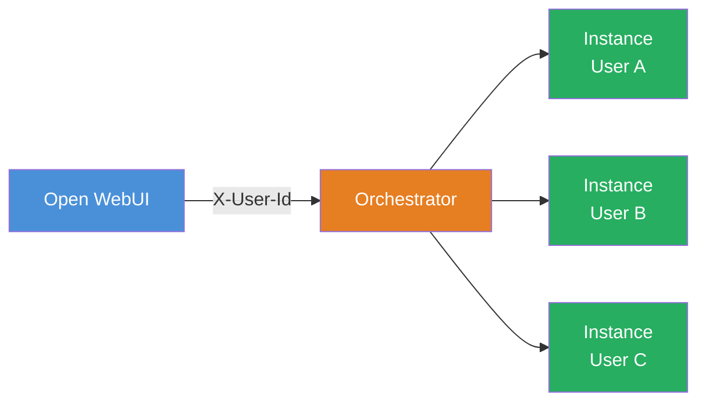

import Tabs from '@theme/Tabs';
import TabItem from '@theme/TabItem';

import Docker from './tab-deployment/Docker.md';
import Kubernetes from './tab-deployment/Kubernetes.md';

# Terminals（编排器） {#terminals-orchestrator}

**Terminals** 为团队管理 [Open Terminal](/features/open-terminal) 实例。每个实例都是一个容器，供 AI 运行命令和处理文件。实例可以归某个用户、聊天或模型使用，也可供所有人共享，并拥有独立的文件、进程、软件包、资源限制、网络配置和可选的持久存储。

[在 GitHub 上查看 →](https://github.com/open-webui/terminals)

Open Terminal 为 Open WebUI 聊天提供实际可操作的工作区。Terminals 为多人管理这些工作区，无需手动接入容器，就能将合适的工作区分配给每个人。你可以在 Open WebUI 中创建、共享和使用终端，由 Terminals 启动、复用和清理相应的实例。

Terminals 可为每个人、聊天或模型提供独立的工作区，使文件和进程彼此隔离。它还可以预先配置环境：设置好镜像、资源、启动目录和初始化脚本，即可将终端共享给群组。空闲实例会在达到设定的空闲超时后清理。Terminals 面向为团队运行 Open WebUI 的管理员。团队成员需要各自的文件、工具和限制，一个共享的 Open Terminal 不再够用时，可以使用 Terminals。

:::tip 快速导航
- **需要操作用户终端环境？** → [编排指南](/features/open-terminal/terminals/orchestration)
- **需要创建和共享终端？** → [创建终端](/features/open-terminal/terminals/orchestration/creating-terminals)
:::

---

## 工作原理 {#how-it-works}

编排器位于 Open WebUI 与 Open Terminal 实例之间：

1. 用户在 Open WebUI 中启用 Open Terminal。
2. Open WebUI 将请求代理到负责管理工作区生命周期的**编排器**。
3. 编排器读取选中的[终端](/features/open-terminal/terminals/orchestration/creating-terminals)配置，包括镜像、资源、存储、环境变量、启动目录、初始化脚本及实例范围。
4. 根据终端的实例范围，编排器启动或复用相应的 Open Terminal 实例。可以为每个用户、聊天或模型提供独立实例，也可以让所有人共用一个实例。
5. 所有流量均经过编排器。
6. 空闲实例会在达到设定的空闲超时后清理。主目录中的文件会保留：Docker 将其保存在数据目录中，Kubernetes 在启用存储时将其保存在持久卷上。

编排器提供与 Open Terminal 相同的、基于 OpenAPI 的工具接口。AI 可以在终端范围所选定的实例中处理文件、运行代码、执行命令、启动服务器并检查结果。

## 为什么重要 {#why-it-matters}

Terminals 让管理员可以为智能体提供实际工作所需的环境，同时控制其使用限制：

| 需求 | Terminals 提供什么 |
| :--- | :--- |
| 隔离 | 各实例拥有独立的文件和进程。可按终端设置为每个用户、已保存聊天或模型分配独立实例 |
| 管理 | 为终端指定镜像、环境变量、资源限制和存储。配置会按服务器上限核验，终端只与选定的用户和群组共享 |
| 可重复性 | 自定义镜像和启动包，让用户每次都拿到正确的工具 |
| 生命周期 | 复用、空闲清理，以及启动、停止、重启和删除单个实例 |
| 扩展 | 单主机用 Docker，更大的部署用 Kubernetes / operator 模式 |
| 运维支持 | 管理界面、日志、状态、模板 API 和可预测的路由 |

:::info 管理界面
编排器在 `/` 提供内置的简易管理界面。通过 **Templates** 可以创建、编辑和删除终端，也可以配置定时重置。通过 **Environments** 可以检查实例（包括已停止的实例），也可以启动、停止、重启、重置或删除实例。使用 `TERMINALS_API_KEY` 登录。该界面默认启用，由 `TERMINALS_ENABLE_UI` 控制。仅部署 API 时将其设为 `false`。
:::

---

## 部署 {#deployment}

<Tabs>
  <TabItem value="docker" label="Docker" default>
    

      <Docker />
    

  </TabItem>
  <TabItem value="kubernetes" label="Kubernetes Operator 部署">
    

      <Kubernetes />
    

  </TabItem>
</Tabs>

---

## 认证 {#authentication}

Open WebUI 与编排器共用同一个 API 密钥。在编排器上设置 `TERMINALS_API_KEY`，然后在 Open WebUI 的连接中将 **Auth** 设为 **Bearer**，并在 **API Key** 中填写相同的值。Open WebUI 检查谁有权使用终端。终端请求携带经验证的用户 ID，编排器接受携带密钥的请求。请妥善保管密钥，因为它也能访问内置管理界面和模板 API。

如果未设置 `TERMINALS_API_KEY`，`terminals serve` 会生成并输出一个密钥。每次重启都会生成不同的密钥，因此实际部署时请设置固定值。

使用 Helm 时，Chart 会生成共享密钥并在两端完成配置。使用 Docker Compose 时，请在 Compose 文件旁的 `.env` 文件中设置 `TERMINALS_API_KEY`。参见[部署](#deployment)。

Open WebUI 发出的所有调用都使用该密钥，包括 **Verify Connection**、Terminals API 调用及终端流量。这些请求也携带用户 ID 和 `X-Terminal-*` [请求头](/features/open-terminal/terminals/orchestration/api-troubleshooting#headers-sent-to-the-terminals-server)。

---

## 排查问题 {#troubleshooting}

### 终端无法启动 {#terminal-wont-start}

1. **查看编排器日志。** 编排器记录完整的实例置备流程，包括拉取镜像和创建工作区。检查与镜像可用性、终端设置或资源限制有关的错误。
2. **核对 API 密钥。** 确认 Open WebUI 和编排器的 `TERMINALS_API_KEY` 一致。两端不匹配会导致连接失败并返回 `401` 错误。
3. **检查镜像拉取权限。** 如果使用私有容器镜像仓库，请确保编排器（Docker）或集群（Kubernetes）已配置拉取凭据。
4. **提高超时时间。** 如果请求以 `Terminal '<name>' timed out. It may still be starting.` 失败，请提高 [`AIOHTTP_CLIENT_TIMEOUT_TERMINAL`](/reference/env-configuration#aiohttp_client_timeout_terminal)。

### 认证失败 {#authentication-failures}

- 确认两端的密钥完全一致。检查是否多出空白字符或换行。
- 查看编排器日志中的 `401` 或 `403` 响应。

### 工作区被过早回收 {#workspace-is-reaped-too-quickly}

延长空闲超时时间。参见[空闲清理、最长运行时间和计划重置](/features/open-terminal/terminals/orchestration#idle-cleanup-lifetime-and-scheduled-resets)。

### 连接被拒绝 {#connection-refused}

- **Docker：** 确认已设置 `TERMINALS_DOCKER_NETWORK`，使容器可通过名称互相通信。未设置时，容器使用已发布的端口，且必须能访问 `TERMINALS_DOCKER_HOST` 指定的地址。
- **Kubernetes：** 验证编排器 Service 是否可从 Open WebUI Pod 访问。运行 `kubectl get svc -n open-webui` 确认服务存在。

---

## 延伸阅读 {#further-reading}

- [多用户配置](../advanced/multi-user)：隔离方式对比
- [安全最佳实践](../advanced/security)
- [配置参考](../advanced/configuration)：所有 Open Terminal 容器设置

---

## 许可证 {#license}

Terminals 在生产环境中使用需要 [Open WebUI 企业许可证](/enterprise)。详情请参阅 [Terminals 仓库](https://github.com/open-webui/terminals)。
