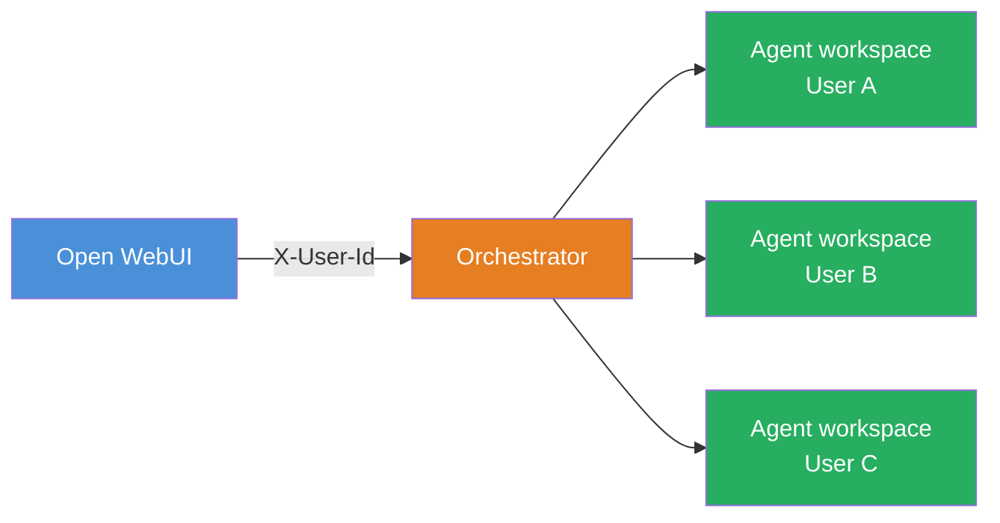

import Tabs from '@theme/Tabs';
import TabItem from '@theme/TabItem';

import Docker from './tab-deployment/Docker.md';
import Kubernetes from './tab-deployment/Kubernetes.md';

# Terminals（编排器） {#terminals-orchestrator}

**Terminals** 是 [Open Terminal](/features/open-terminal) 的企业级编排层。它为每位 Open WebUI 用户配置一个专用的计算底层环境：独立的文件、进程、软件包环境、资源限制、网络边界以及可选的持久化存储。

[在 GitHub 上查看 →](https://github.com/open-webui/terminals)

Open Terminal 将一个 Open WebUI 聊天窗口转变为一个完整的代理框架，并提供可供操作的真实工作区。Terminals 则将其转化为受管的工作区集群基础设施，从而确保每位用户或每项策略都能获得合适的工作区，而无需共享状态或手动配置容器。

Open WebUI 是配置、管理和监控该框架的地方。Terminals 是该框架内部的工作区生命周期层：它负责为代理提供、隔离、复用、刷新和重置代理用于执行实际工作的计算底层资源。

:::tip 快速导航
- **需要操作用户终端环境？** → [编排指南](/features/open-terminal/terminals/orchestration)
:::

---

## 工作原理 {#how-it-works}

编排器位于 Open WebUI 和 Open Terminal 实例之间：

1. 用户在 Open WebUI 中激活一个终端。
2. Open WebUI 将请求代理到**编排器**——一个管理终端容器生命周期的服务。
3. 编排器解析所选的策略：镜像、资源、存储、环境变量、安全上下文和空闲超时。
4. 编排器为该用户与该策略分配或复用个人 Open Terminal 工作区；当连接按聊天或按自动化限定缩时，还会根据[终端上下文](/features/open-terminal/terminals/orchestration/contexts)区分。
5. 所有流量均通过编排器代理。用户永远不会直接连接到自己的工作区。
6. 空闲工作区在可配置的超时时间后自动清理。开启存储后，文件可在会话间持久化。

编排器还暴露与 Open Terminal 相同的基于 OpenAPI 的工具接口，因此 AI 可以处理文件、运行代码、执行命令、启动服务器并查看结果，所有操作都限定在发起请求的用户工作区范围内。

---

## 为什么重要 {#why-it-matters}

Terminals 让完整的智能体框架在团队中真正可用。它让管理员在为智能体提供足够环境去完成实际工作的同时，仍然牢牢控制着边界：

| 需求 | Terminals 提供什么 |
| :--- | :--- |
| 隔离 | 每位用户、每种策略一个工作区，文件和进程彼此分开；还可以按已保存的聊天或按自动化各自划分 |
| 治理 | 由策略控制的镜像、环境变量、资源限制、存储和安全上下文 |
| 可重复性 | 自定义镜像和启动包，让用户每次都拿到正确的工具 |
| 生命周期 | 复用、空闲清理、刷新和定时重置 |
| 扩展 | 单主机用 Docker，更大的部署用 Kubernetes / operator 模式 |
| 可运维性 | 管理界面、日志、状态、策略 API，以及可预期的路由 |

从框架工程的角度看，Terminals 掌管工作区的整个生命周期：provision（置备）、route（路由）、persist（持久化）、reap（回收）、refresh（刷新）和 reset（重置）。

:::info 管理界面
编排器在 `/` 上提供一个内置的极简管理界面，用于查看终端状态、活动会话和策略。它默认开启，可以通过 `TERMINALS_ENABLE_UI` 切换；只需要 API 的部署请把它设为 `false`。
:::

---

## 部署 {#deployment}

<Tabs>
  <TabItem value="docker" label="Docker" default>
    

      <Docker />
    

  </TabItem>
  <TabItem value="kubernetes" label="Kubernetes Operator">
    

      <Kubernetes />
    

  </TabItem>
</Tabs>

---

## 认证 {#authentication}

编排器支持三种认证模式：

| 模式 | 适用场景 | 配置方式 |
| :--- | :--- | :--- |
| **Open WebUI JWT** | 生产环境。编排器验证 Open WebUI 实例的 token。 | 在编排器上将 `TERMINALS_OPEN_WEBUI_URL` 设置为你的 Open WebUI URL。 |
| **共享 API Key** | 标准方式。Open WebUI 在每个请求中携带共享密钥。 | 在 Open WebUI 和编排器上将 `TERMINALS_API_KEY` 设置为相同的值。 |
| **开放模式** | 仅用于开发。无认证，不可在生产中使用。 | 将 `TERMINALS_OPEN_WEBUI_URL` 和 `TERMINALS_API_KEY` 都留空。 |

通过 Docker Compose 或 Helm 部署时，Open WebUI 和编排器之间的共享 API Key 会自动配置。

JWT 模式需要两边达成一致。编排器会针对发起请求的用户身份校验每个请求，因此 Open WebUI 必须发送该用户自己的 token，而不是一个共享密钥。连接上的 **Auth > Session** 会为模型的工具、编码智能体、文件浏览器和终端面板完成这件事。在 JWT 模式下使用 **Auth > Bearer** 会导致认证失败，表现为终端一打开就关闭。

策略、生命周期、状态和刷新类 API 使用编排器自己的 `TERMINALS_API_KEY`，无论使用哪种模式都不会使用用户 token。即使在 JWT 模式下也要保留这个密钥，并在你自己调用这些端点时把它带上。当 **Auth** 设为 **Bearer** 或 **Session** 时，Open WebUI 会把连接的 **API Key** 附加到验证连接、策略、生命周期和刷新调用，以及终端工具列表的加载上。请在那里填入编排器的 `TERMINALS_API_KEY`。

---

## 排查问题 {#troubleshooting}

### 终端无法启动 {#terminal-wont-start}

1. **检查编排器日志。** 编排器会记录完整的分配流程，包括镜像拉取和工作区创建。查找与镜像可用性、策略配置或资源限制相关的错误。
2. **验证 API Key。** 确保 `TERMINALS_API_KEY` 在 Open WebUI 和编排器之间一致。不匹配会导致静默认证失败。
3. **检查镜像拉取权限。** 如果使用私有容器镜像仓库，请确保编排器（Docker）或集群（Kubernetes）已配置拉取凭据。
4. **提高超时时间。** 如果请求以 `Terminal '<name>' timed out. It may still be starting.` 失败，请提高 [`AIOHTTP_CLIENT_TIMEOUT_TERMINAL`](/reference/env-configuration#aiohttp_client_timeout_terminal)。

### 认证失败 {#authentication-failures}

- 使用 **JWT 模式**时，确认 `TERMINALS_OPEN_WEBUI_URL` 指向可访问的 Open WebUI 实例，连接的 **Auth** 已设为 **Session**，并且它的 **API Key** 与 `TERMINALS_API_KEY` 一致。
- 使用 **API Key 模式**时，确认两端的密钥完全一致。检查是否有多余的空格或换行。
- 查看编排器日志中的 `401` 或 `403` 响应。

### 容器被过快清理 {#workspace-is-reaped-too-quickly}

增大 `TERMINALS_IDLE_TIMEOUT_MINUTES`（或策略中的 `idle_timeout_minutes`）。默认值为 `0`（禁用），但如果设置过低，容器可能在用户还在工作时就被清理掉。`30` 是一个典型值。

### 连接被拒绝 {#connection-refused}

- **Docker：** 确保设置了 `TERMINALS_NETWORK`，使容器可以通过名称互相通信。若未设置，容器使用已发布的端口，且 `TERMINALS_DOCKER_HOST` 地址必须可访问。
- **Kubernetes：** 验证编排器 Service 是否可从 Open WebUI Pod 访问。运行 `kubectl get svc -n open-webui` 确认服务存在。

---

## 延伸阅读 {#further-reading}

- [多用户配置](../advanced/multi-user)：隔离方式对比
- [安全最佳实践](../advanced/security)
- [配置参考](../advanced/configuration)：所有 Open Terminal 容器设置

---

## 许可证 {#license}

Terminals 在生产环境中使用需要 [Open WebUI 企业许可证](/enterprise)。详情请参阅 [Terminals 仓库](https://github.com/open-webui/terminals)。
