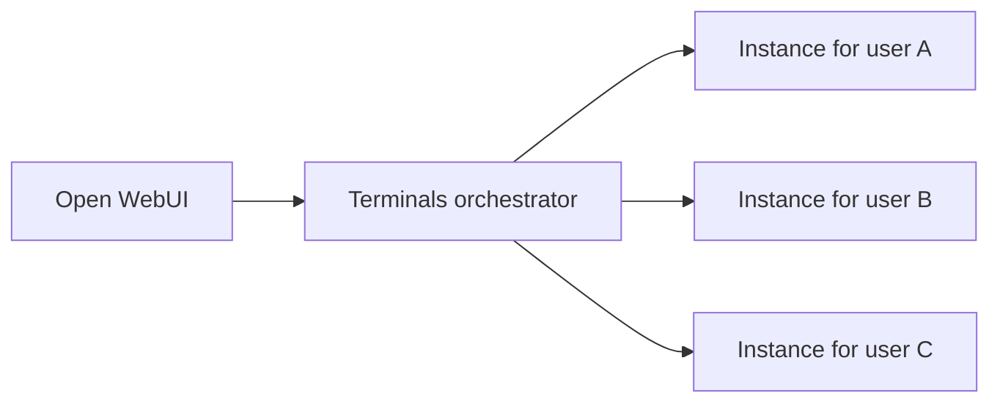

# 编排 {#orchestration}

Terminals 编排器为团队启动和管理 [Open Terminal](/features/open-terminal) 实例。Open WebUI 保存连接，用户可通过连接创建终端。终端会启动实例，供智能体运行命令和处理文件。根据终端的实例范围，实例可以归某个用户、聊天或模型使用，也可以供所有人共享。

当 Open Terminal 需要作为受管理的团队基础设施使用，且不同用户、群组或工作流需要不同的镜像、工具、限制、存储行为或安全边界时，可使用 Terminals。

用户在终端中工作时，Open WebUI 会将请求发给编排器。请求携带终端 ID。如果请求属于已保存的聊天，还携带聊天 ID。如果终端的实例范围为模型，则携带模型 ID。编排器会启动或复用相应的实例。

## 阅读本节 {#read-this-section}

- [创建终端](/features/open-terminal/terminals/orchestration/creating-terminals)：配置对话框、实例范围、共享和实例管理。
- [环境变量](/features/open-terminal/terminals/orchestration/environment-variables)：原始值、引号处理、转发行为和保留键。
- [自定义镜像](/features/open-terminal/terminals/orchestration/custom-images)：构建、标记、推送和使用自定义 Open Terminal 镜像。
- [系统提示词](/features/open-terminal/terminals/orchestration/system-prompts)：自动生成的提示词、`OPEN_TERMINAL_SYSTEM_PROMPT`、占位符和 `OPEN_TERMINAL_INFO`。
- [文件浏览器根目录](/features/open-terminal/terminals/orchestration/file-browser-home-boundary)：Open Terminal 如何为客户端暴露可视根目录以渲染和限制导航。
- [OpenShift](/features/open-terminal/terminals/orchestration/openshift)：OpenShift 上的受限终端沙箱。
- [API 与故障排除](/features/open-terminal/terminals/orchestration/api-troubleshooting)：模板 API、发往服务器的请求头以及常见问题。

## 职责划分 {#responsibilities}

| 层 | 职责 |
| :--- | :--- |
| Open WebUI | 存储编排器连接，让用户创建和共享终端，并提供聊天、终端、文件浏览器和预览界面 |
| Terminals 编排器 | 验证服务器密钥、存储终端、置备实例、转发环境变量、执行空闲清理与计划重置，并强制执行服务器上限 |
| 终端 | 定义镜像、环境变量、资源、存储、启动目录、初始化脚本和实例范围 |
| Open Terminal 实例 | 执行命令、提供文件、公开 OpenAPI 工具、运行代码和服务器，并报告文件浏览器的根目录元数据 |

## 编排器环境变量 {#orchestrator-environment-variables}

这些变量用于配置编排器服务本身，以 `TERMINALS_` 为前缀，也可在 `.env` 文件中设置。它们不同于[环境变量](/features/open-terminal/terminals/orchestration/environment-variables)中每个工作区各自的 `OPEN_TERMINAL_*` 变量，后者会转发到各用户的 Open Terminal 工作区。

| 变量 | 默认值 | 描述 |
| :--- | :--- | :--- |
| `TERMINALS_BACKEND` | `docker` | 使用的后端：`docker`、`kubernetes` 或 `kubernetes-operator` |
| `TERMINALS_API_KEY` | *（由 `terminals serve` 生成）* | Open WebUI 和管理界面发送的 Bearer 令牌。请设置固定值，自动生成的值会在每次重启后变化 |
| `TERMINALS_HOST` | `0.0.0.0` | 编排器 HTTP 服务器绑定的地址 |
| `TERMINALS_PORT` | `3000` | 编排器 HTTP 服务器监听的端口 |
| `TERMINALS_WORKERS` | `1` | 服务器进程数 |
| `TERMINALS_ENABLE_UI` | `true` | 在 `/` 提供内置的最小化管理 UI。API-only 部署设置为 `false` |
| `TERMINALS_LOG_LEVEL` | `INFO` | 最低日志级别：`DEBUG`、`INFO`、`WARNING`、`ERROR` 或 `CRITICAL` |
| `TERMINALS_DATABASE_URL` | `sqlite+aiosqlite:///<data>/terminals.db` | SQLAlchemy 数据库 URL。默认为 SQLite；PostgreSQL 可选 |
| `TERMINALS_IMAGE` | `ghcr.io/open-webui/open-terminal:latest` | 终端未指定镜像时使用的默认工作区镜像 |
| `TERMINALS_IMAGE_PULL_POLICY` | *（未设置）* | 各后端通用，可设为 `Always`、`IfNotPresent` 或 `Never`。未设置时，使用 `:latest` 标签及未指定标签的镜像会在每次启动时拉取。其他标签的镜像仅在本地缺失时拉取 |
| `TERMINALS_NETWORK_PROFILES` | `{}` | 包含具名网络配置的 JSON 对象，可在终端的 **Network** 字段中选择这些配置 |
| `TERMINALS_DOCKER_NETWORK` | *（未设置）* | Open Terminal 工作区使用的 Docker 网络。设置后可通过该网络按名称访问容器。逗号分隔的列表可将容器分布到多个网络 |
| `TERMINALS_DOCKER_HOST` | `127.0.0.1` | 用于访问已发布容器端口的地址（Docker 后端） |
| `TERMINALS_DOCKER_DATA_DIR` | `<data>/terminals` | 保存工作区持久文件的目录，Docker 后端为每个实例分配一个 `.terminals/<id>` 文件夹 |
| `TERMINALS_DOCKER_HOST_DATA_DIR` | *（未设置）* | 当该目录在 Docker 主机上的路径与 `TERMINALS_DOCKER_DATA_DIR` 不同时，填写主机上的绝对路径 |
| `TERMINALS_DOCKER_MOUNTS` | *（未设置）* | 为每个实例添加额外绑定挂载的 JSON 数组（Docker 后端）。包含 `source`、`target` 以及可选的 `readOnly` |
| `TERMINALS_IDLE_TIMEOUT_MINUTES` | `0` | 实例闲置 N 分钟后停止，`0` 表示禁用 |
| `TERMINALS_MAX_LIFETIME_MINUTES` | `0` | 实例启动 N 分钟后停止，即使仍在使用，`0` 表示禁用 |
| `TERMINALS_MAX_CPU` | *（未设置）* | 各工作区的 CPU 硬上限，终端不能超出 |
| `TERMINALS_MAX_MEMORY` | *（未设置）* | 各工作区的内存硬上限，终端不能超出 |
| `TERMINALS_MAX_STORAGE` | *（未设置）* | 各工作区的存储硬上限，终端不能超出 |
| `TERMINALS_ALLOWED_IMAGES` | *（未设置）* | 逗号分隔的允许镜像模式列表（glob）。空值允许任何镜像 |
| `TERMINALS_KUBERNETES_NAMESPACE` | `terminals` | 终端 Pod 的命名空间（Kubernetes 后端） |
| `TERMINALS_KUBERNETES_IMAGE` | *（未设置）* | Kubernetes 后端的 Open Terminal Pod 默认镜像。未设置时使用 `TERMINALS_IMAGE` |
| `TERMINALS_KUBERNETES_STORAGE_CLASS` | *（未设置）* | PVC 的 StorageClass。空值使用集群默认值 |
| `TERMINALS_KUBERNETES_STORAGE_SIZE` | `1Gi` | 终端未指定大小时使用的默认 PVC 大小 |
| `TERMINALS_KUBERNETES_STORAGE_MODE` | `per-user` | 存储模式：`per-user`、`shared` 或 `shared-rwo` |
| `TERMINALS_KUBERNETES_SERVICE_TYPE` | `ClusterIP` | 终端 Pod 的服务类型 |
| `TERMINALS_KUBERNETES_KUBECONFIG` | *（未设置）* | kubeconfig 的路径。空值使用集群内配置 |
| `TERMINALS_KUBERNETES_LABELS` | *（未设置）* | 以 `k=v,k2=v2` 格式应用于创建资源的额外标签 |
| `TERMINALS_KUBERNETES_RESTRICTED` | `false` | 全局启用受限的 Kubernetes/OpenShift Pod 默认值 |
| `TERMINALS_KUBERNETES_POD_SECURITY_CONTEXT` | `{}` | JSON Pod 安全上下文，合并到终端 Pod 中 |
| `TERMINALS_KUBERNETES_CONTAINER_SECURITY_CONTEXT` | `{}` | JSON 容器安全上下文，合并到 Open Terminal 容器中 |
| `TERMINALS_KUBERNETES_NODE_SELECTOR` | *（未设置）* | 用于实例 Pod 和重置 Pod 的节点选择器，格式为 JSON 或 `k=v,k2=v2` |
| `TERMINALS_KUBERNETES_TOLERATIONS` | *（未设置）* | 用于实例 Pod 和重置 Pod 的容忍度 JSON 数组 |
| `TERMINALS_KUBERNETES_CRD_GROUP` | `openwebui.com` | Operator 后端监控的 CRD 组 |
| `TERMINALS_KUBERNETES_CRD_VERSION` | `v1alpha1` | Operator 后端监控的 CRD 版本 |

未设置的项使用表中所列的默认值。[Terminals README](https://github.com/open-webui/terminals#configuration) 列出了所有设置，包括代理超时和缓存。

## 重要行为 {#important-behavior}

对终端的修改会应用于之后启动的实例。**Restart** 会停止实例，并立即按当前设置重新启动。

### 空闲清理、最长运行时间和计划重置 {#idle-cleanup-lifetime-and-scheduled-resets}

实例闲置达到 `TERMINALS_IDLE_TIMEOUT_MINUTES` 后，空闲清理会停止该实例并保留文件。下一次请求会启动一个新实例并使用这些文件。`TERMINALS_MAX_LIFETIME_MINUTES` 会在实例启动一段固定时间后停止实例，即使实例仍在使用，也会保留文件。终端可用自己的 `idle_timeout_minutes` 和 `max_lifetime_minutes` 覆盖服务器值。设为 `0` 可对该终端禁用相应检查。

重置计划会定时清除终端的文件，并刷新相应的实例，包括正在使用的实例。可以使用一次性的 ISO 日期时间、`@weekly`、`@monthly` 或五字段 cron 表达式，还可指定时区。请在 Terminals 管理界面的模板编辑器中设置。

文件浏览器从主目录开始，并隐藏上级文件夹。参见[文件浏览器根目录](/features/open-terminal/terminals/orchestration/file-browser-home-boundary)。
