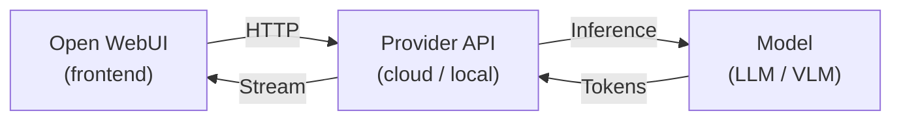

# 连接本地与云端模型 {#connect-a-provider}

将本地模型服务器与云端 API 连接到同一个 Open WebUI 实例。为每个提供商添加一条连接，然后选择在对话中使用哪个模型。

Open WebUI 支持多种连接协议，包括 **Ollama**、**兼容 OpenAI 的 API** 与 **Open Responses**。任何实现这些协议的云端 API 或本地服务器都可以开箱即用。你只需填写 URL 和 API 密钥，你的模型就会出现在下拉列表中。

---

## 工作原理 {#how-it-works}

1. **你在 Open WebUI 中输入消息**
2. Open WebUI 将消息发送到你的提供商 API 端点
3. 提供商在所选模型上执行推理
4. token **实时流式返回**到 Open WebUI
5. 你在聊天界面中看到回复

:::tip
添加提供商通常只需要在 **设置 → 管理 → 连接** 中填写 URL 和 API 密钥。对于大多数提供商，Open WebUI 都能自动发现可用模型。
:::

---

## 同时使用本地与云端模型 {#use-local-and-cloud-models-together}

你需要：一个正在运行的 Open WebUI 实例、管理员权限、一个可访问的本地模型服务器，以及你所选择的托管提供商的 API 密钥。

1. [连接 Ollama](/getting-started/quick-start/connect-a-provider/starting-with-ollama)，并确认已下载的本地模型出现在模型选择器中。
2. 按照 [OpenAI](/getting-started/quick-start/connect-a-provider/starting-with-openai)、[Anthropic](/getting-started/quick-start/connect-a-provider/starting-with-anthropic) 或[兼容 OpenAI 的提供商](/getting-started/quick-start/connect-a-provider/starting-with-openai-compatible) 指南添加一条托管连接。
3. 开始一段对话，选择本地模型，发送一条简短的测试消息。然后另起一段对话选择托管模型，确认它也能正常回复。
4. 若要把同一条提示词同时发送给两个模型，请使用[多模型对话](/features/chat-conversations/chat-features/multi-model-chats)。

所选的端点决定了推理发生的位置。选择云端模型会把提示词和附带上下文发送到该提供商；比较模型时，提示词会分别发送到每个选中的端点。本地推理并不会让单独配置的云端工具、文档提取或嵌入服务变成本地执行。对于敏感内容，请参阅[聊天数据隐私与加密](/security/chat-data-privacy-and-encryption)来选择合适的提供商。

## 云端提供商 {#cloud-providers}

需要账户和 API 密钥的托管 API。无需任何硬件。

| 提供商 | 模型 | 指南 |
|----------|--------|-------|
| **OpenAI** | GPT-5.6 Sol、GPT-5.6 Terra、GPT-5.6 Luna | [从 OpenAI 开始 →](/getting-started/quick-start/connect-a-provider/starting-with-openai) |
| **Anthropic** | Claude Opus 5、Sonnet 5、Haiku 4.5 | [从 Anthropic 开始 →](/getting-started/quick-start/connect-a-provider/starting-with-anthropic) |
| **兼容 OpenAI** | DeepSeek、Mistral、Groq、OpenRouter、Vercel AI Gateway、Amazon Bedrock、Azure 等 | [兼容 OpenAI 的提供商 →](/getting-started/quick-start/connect-a-provider/starting-with-openai-compatible) |

---

## 本地服务器 {#local-servers}

在你自己的硬件上运行已下载的模型。认证方式取决于本地服务器的配置方式。

| 服务器 | 说明 | 指南 |
|--------|-------------|-------|
| **Ollama** | 在本地运行和管理已下载的模型 | [从 Ollama 开始 →](/getting-started/quick-start/connect-a-provider/starting-with-ollama) |
| **llama.cpp** | 通过兼容 OpenAI 的 API 高效进行 GGUF 模型推理 | [从 llama.cpp 开始 →](/getting-started/quick-start/connect-a-provider/starting-with-llama-cpp) |
| **vLLM** | 面向生产负载的高吞吐推理引擎 | [从 vLLM 开始 →](/getting-started/quick-start/connect-a-provider/starting-with-vllm) |

更多本地服务器（LM Studio、LocalAI、Docker Model Runner、Lemonade）可参见[兼容 OpenAI 的提供商](/getting-started/quick-start/connect-a-provider/starting-with-openai-compatible#local-servers)指南。

---

## 其他连接方式 {#other-connection-methods}

| 功能 | 说明 | 指南 |
|---------|-------------|-------|
| **Open Responses** | 通过 Open Responses 规范连接提供商 | [从 Open Responses 开始 →](/getting-started/quick-start/connect-a-provider/starting-with-open-responses) |
| **Functions** | 通过自定义 pipe functions 将任意后端接入 Open WebUI | [从 Functions 开始 →](/getting-started/quick-start/connect-a-provider/starting-with-functions) |

---

## 在找 Agent？ {#looking-for-agents}

如果你想连接的是一个自主 AI Agent（具备终端访问、文件操作、网页搜索等能力），而不是普通的模型提供商，请参阅[**连接 Agent**](/getting-started/quick-start/connect-an-agent)。
