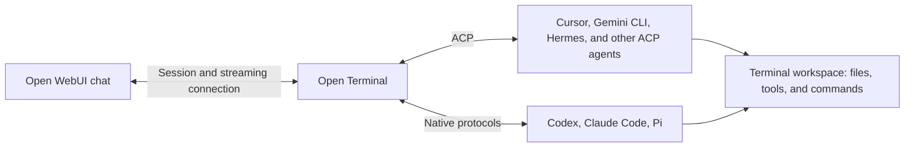

# 🤖 连接 Agent {#connect-an-agent}

**用 Open Terminal 在 Open WebUI 中运行 Agent，或接入已有的 Agent 网关。**

Agent 框架是围绕模型的一层软件，负责管理工具、指令、权限，以及"采取行动并检查结果"的循环。Open WebUI 可以用普通模型加 Open Terminal 跑起这个循环，也可以在同一个聊天界面中接入 Claude Code、Codex 或 Hermes 这样的独立框架。

## 选择你的接入方式 {#choose-your-setup}

| 你想要 | 接入方式 | 在哪里连接 |
| :--- | :--- | :--- |
| 让现有模型拥有用于命令、文件和代码的工作区 | **Open WebUI + Open Terminal**：Open WebUI 管理模型的工具调用，Open Terminal 负责执行 | **Settings > Integrations > Open Terminal**（管理员区域） |
| 在聊天中使用 Claude Code、Codex、Cursor、Gemini CLI、Hermes 或其他受支持的 Agent | **通过 Open Terminal 使用 Agent**：Agent CLI 在终端环境中运行，自带工具和 Agent 循环 | 同一个 **Open Terminal** 连接；先选终端，再选 Agent 模型 |
| 使用你已经在运维的 Agent 服务 | **Agent 网关**：Open WebUI 将聊天请求发送到该服务兼容 OpenAI 的 API | **Settings > Connections > OpenAI**（管理员区域） |

如果是全新接入，先从 **Open Terminal** 开始。一个连接就能同时为普通模型提供工作区，并让你访问其中安装的受支持 Agent CLI。

## 用 Open Terminal 快速开始 {#quick-start-with-open-terminal}

### 1. 准备终端环境 {#1-prepare-the-terminal-environment}

按 [Open Terminal 安装指南](/features/open-terminal/setup/installation)操作。选择 Docker 以获得容器工作区，或选择裸机以使用宿主机上的文件和工具。

如果你要用 **Codex 或 Claude Code**，`ghcr.io/open-webui/open-terminal:agents` 镜像已包含这两个 CLI。全新 Docker 安装示例：

```bash
docker run -d \
  --name open-terminal \
  --restart unless-stopped \
  -p 8000:8000 \
  -v open-terminal:/home/user \
  -e OPEN_TERMINAL_API_KEY=your-secret-key \
  ghcr.io/open-webui/open-terminal:agents
```

把 `your-secret-key` 换成你自己的密钥。已有安装请按[更新指南](/features/open-terminal/setup/updating)操作，更换镜像时保留工作区卷。

### 2. 安装并登录你的 Agent {#2-install-and-sign-in-to-your-agent}

如果使用带终端工具的普通模型，继续第 3 步。如果使用 Agent CLI，请把它**安装在运行 Open Terminal 的环境内部**，并以终端的操作系统用户完成登录或提供商配置。装在你笔记本电脑上的 CLI 不会自动出现在 Docker 容器或远程终端里。

对于上面的 Docker 容器，打开一个 shell：

```bash
docker exec -it open-terminal bash
```

运行 `codex` 或 `claude` 并完成设置。其他 Agent 请在同一个环境中按其安装说明操作。接入聊天前，先确认 Agent 能在该环境中响应提示词。参见[受支持的 Agent](/features/open-terminal/coding-agents#supported-agents)和 [Agent 部署指南](https://github.com/open-webui/open-terminal/blob/main/docs/deployment.md#coding-agents)。

**Open Terminal API 密钥**用于验证到终端服务器的连接。每个 Agent 还需要各自的登录凭据或模型提供商凭据。请保持主目录卷挂载，以便更换容器后仍能保留存放在文件中的 Agent 设置和凭据。

### 3. 连接 Open Terminal {#3-connect-open-terminal}

在 Open WebUI 中打开 **Admin** 分区下的 **Settings > Integrations**。在 **Open Terminal** 中添加终端的 URL 和 API 密钥，保存并启用该连接。

使用 Open WebUI 服务器能访问到的地址：例如在共享的 Docker Compose 网络上用 `http://open-terminal:8000`，两个进程直接运行在同一台机器上时用 `http://localhost:8000`。分离的容器、远程主机和访问授权请按[连接指南](/features/open-terminal/setup/connecting)操作。

### 4. 选择终端和模型 {#4-select-a-terminal-and-model}

开始一个已保存的聊天，点击**终端按钮**（云图标），然后选择你的终端。接着二选一：

- **一个普通模型**，需具备足够强的原生工具调用能力。Open WebUI 会给它终端工具来执行命令、处理文件。如果工具缺失，请检查该模型的[Terminal 能力与绑定](/features/workspace/models#capabilities-and-bindings)。
- **一个 Agent 模型**，命名为 `<agent>/<model>`。Open WebUI 会发现所选终端中可用的 Agent 和模型。只有能成功上报自身模型的 Agent 才会出现。

Agent 会话一次只支持一个 Agent，并且要求是已保存的聊天。可以继续发新消息；不支持重新生成、编辑并重发之前的消息，也不支持分支。完整的聊天行为参见[编码智能体](/features/open-terminal/coding-agents)。

### 5. 试一个任务 {#5-try-a-task}

在[文件浏览器](/features/open-terminal/file-browser)中打开你的项目目录，开始一个新的 Agent 会话，然后提出要求：

> 检查这个项目，说明如何运行它，并运行它已有的测试。报告所有失败项及相应输出。

Agent 在该终端的工作区中工作。工具请求会出现在聊天里，并遵循所选的[工具权限模式](/features/extensibility/plugin/tools#tool-approval)。已存在的 Agent 会话在你浏览其他目录时会保留原有工作目录。

## Open Terminal 如何对接不同的框架 {#how-open-terminal-connects-different-harnesses}

Open Terminal 启动每个受支持的 Agent CLI，并通过它们各自的原生接口通信。**Agent Client Protocol (ACP)** 为许多 Agent 提供统一接口；Codex、Claude Code 和 Pi 则使用各自协议的专用集成。参见[协议与 Agent 列表](/features/open-terminal/coding-agents#supported-agents)。



Open Terminal 会发现已安装 Agent 提供的模型，并以终端用户的身份运行这些 Agent 的进程。Open WebUI 将它们的流式输出、工具请求和提问呈现在聊天中，把附件上传到工作区，并保存会话信息，以便后续消息接续同一会话。可用的模型和可选控制项取决于各个 Agent 上报的内容。

你也可以通过配置[注册另一个 ACP Agent](/features/open-terminal/coding-agents#add-another-acp-agent)。该 Agent 必须支持此集成所用的协议，并能在终端环境中成功运行。

## 接入已有的 Agent 网关 {#connect-an-existing-agent-gateway}

当你想让一个独立运行的 Agent 服务通过兼容 OpenAI 的 API 处理请求时，使用网关连接。

| Agent | 连接方式 | 指南 |
| :--- | :--- | :--- |
| **Hermes Agent** | Hermes 网关兼容 OpenAI 的 API；Hermes 也可通过 Open Terminal 的 ACP 集成接入 | [配置 Hermes 网关](/getting-started/quick-start/connect-an-agent/hermes-agent) |
| **OpenClaw** | OpenClaw 网关兼容 OpenAI 的 API | [配置 OpenClaw](/getting-started/quick-start/connect-an-agent/openclaw) |

使用网关时，Open WebUI 将对话发送给网关，由远端 Agent 自行管理工作区、工具和执行循环。请按对应指南启用网关接口，并配置其 URL、认证方式和模型 ID。仅兼容 Chat Completions 协议，并不代表支持 Open WebUI 的全部功能，也不代表支持 Agent 的原生审批和会话控制。
